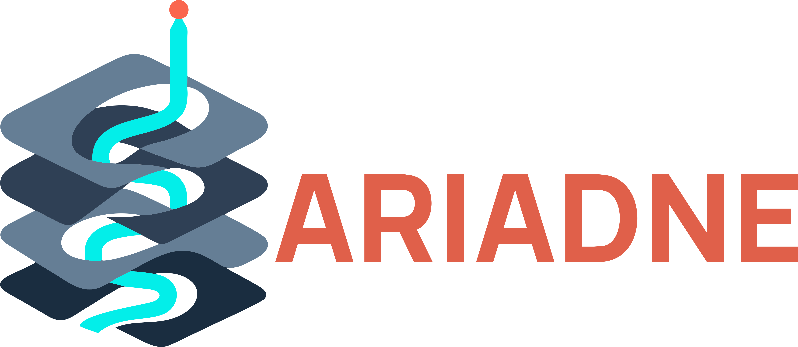
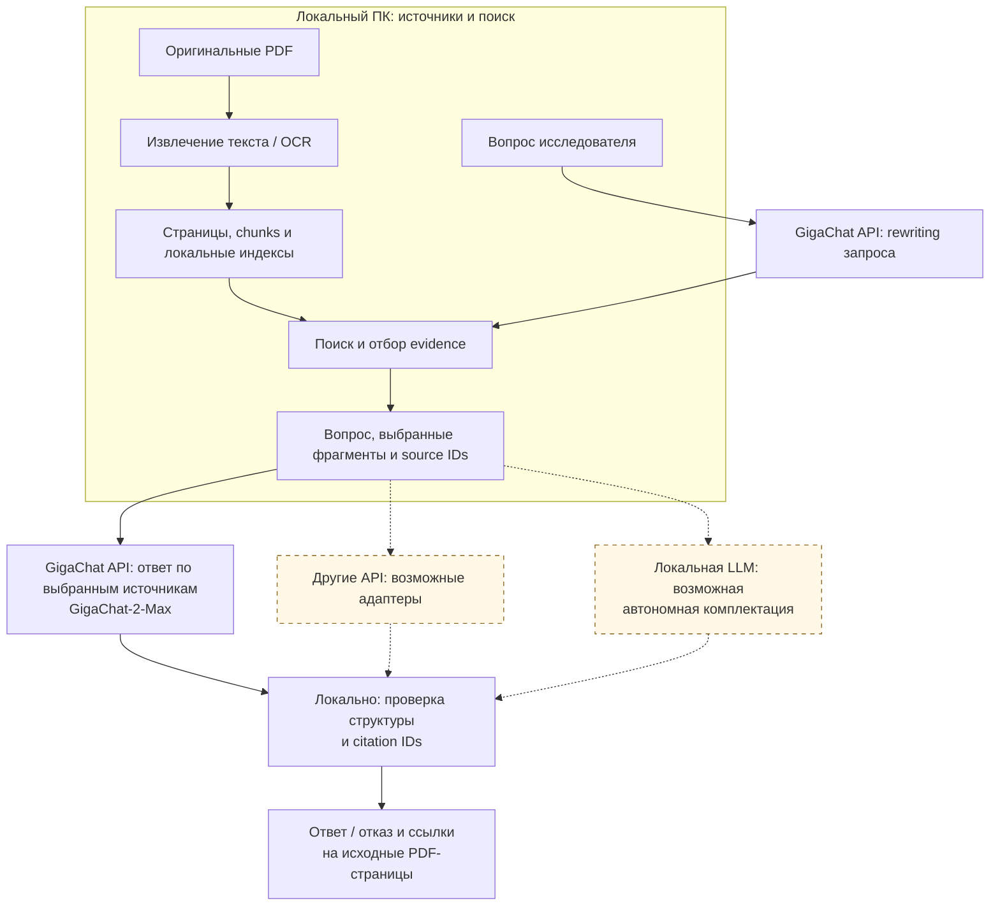

<p align="center">
  
</p>

# ARIADNE

Локальная система для работы с научной литературой о Nafion/PFSA и связанных аккумуляторных материалах. Сохраняет оригинальные PDF, извлекает текст по страницам, строит фрагменты с привязкой к источнику и предоставляет поиск, просмотр доказательств и ответы с цитатами.

Состояние README сверено с исходниками **17 ноября 2026 года**. Текущий веб-путь ответа подключён 16 ноября; это исследовательский прототип, независимая научная приёмка не завершена. Версия Python-пакета — `0.1.0`; концепция проекта `v1.1` в презентациях не является версией программного релиза. Рабочая директория исторически называется `Nafion-RAG`.

## Архитектура MVP и варианты анализа

Направление MVP зафиксировано **22 октября 2026 года**: локальное хранение, подготовка и поиск источников; анализ выбранного evidence через API; локальная проверка структуры ответа и ссылок. С **29 октября** основной answer provider — `gigachat`, модель по умолчанию `GigaChat-2-Max`; фабрика ответов принимает только GigaChat, без fallback на OpenAI. Адаптер проверен локальными транспортными тестами; научная приёмка общего пути ответов остаётся открытой. Исторические records-эксперименты сохраняют исходные провайдеры. Автономная комплектация остаётся планом. [Память решения и ограничения](docs/mvp_inference_strategy_2026-10-22.md).



Сплошные связи показывают текущий `/answer/current` (rewriting → поиск → ответ); пунктирные — варианты расширения. Диаграмма не означает, что полностатейное извлечение экспериментальных записей или научная проверка всех связей завершены. TAC/Terms и records experiments имеют отдельные стадии и ограничения.

Целевой пакет доказательств сохраняет исходные фрагменты и необходимый контекст: заголовки таблиц, единицы, сноски, условия и методику. Неопределённые случаи и `no_literal_cue` не должны исчезать из поиска. Проверка citation IDs не доказывает, что вывод модели научно следует из цитаты; новые провайдеры требуют собственного сравнения качества. Поддержку конкретного API заявляем после реализации и проверки адаптера.

Автономная коробка остаётся возможным вариантом поставки под подтверждённую потребность в закрытом контуре. Первый API-based MVP позволяет проверить полезность системы до доводки аппаратной комплектации; спрос, экономия времени и научная точность ещё требуют измерения.

## Что реализовано

| Подсистема | Возможности в исходниках | Ограничения |
| --- | --- | --- |
| PDF ingestion | Импорт файла/папки через CLI, загрузка через UI/API, постоянные локальные библиотеки, очередь и worker | Нужны PostgreSQL, миграции и доступные файлы |
| Текст и источники | PyMuPDF, OCRmyPDF, оригинальный/OCR/выбранный текстовый слой, детерминированные чанки, контроль PDF и ссылки на страницы | Ошибки OCR, повреждённые глифы и сложная геометрия PDF остаются возможны |
| Retrieval | `exact`, `semantic`, `hybrid`, `hybrid_cross_lingual`, фильтры и группировка; локальные FastEmbed-векторы | Семантическим методам нужен индекс; ограничения группировки могут скрывать нужные фрагменты |
| Индекс | Состояния и поколения индекса, очередь пересборки, фоновая пересборка и очистка поколений | Готовность текста и готовность векторного индекса различаются |
| Ответы | `/answer/current`: rewriting, отбор/дополнение контекста, requirement-guided ответ, проверка обязательных полей и citation IDs; claims/mini-review | До двух модельных запросов; конечные правила не доказывают научную корректность, offline replay не заменяет независимую оценку |
| Подготовка ответа | Отдельные `/answer/prepare` и `/ui/answer/prepare`: поиск, проверка уточнений, source/page diagnostics, весь выбранный текст и PDF-ссылки | Генерация отключена; grammar конечная, scientific acceptance отсутствует; существующий `/answer` остаётся отдельным путём |
| Контексты PDF-блоков | `/answer/prepare/blocks` и `/ui/answer/prepare/blocks`: целые блоки с окружением, условиями/guards и полным исходным baseline | Отложенные/невыбранные блоки сохранены; объединённое покрытие страниц и byte ceiling проверяются; генерации нет |
| Аудит рисков контекста | `/answer/prepare/blocks/risks` и `/ui/answer/prepare/blocks/risks`: точный текст окружения, PDF-ссылки, поиск и layout/visual диагностика | Удалённая геометрия не доказывает нерелевантность; прежние отказы и выбор сохранены; генерация отключена |
| Библиографические метаданные | Прежний TAC-извлекатель подключён к импорту, дубликатам и переотбору текста; `/ui/articles/{id}/bibliography` показывает точные цитаты и историю | Значения остаются предложениями алгоритма; существующие поля сохраняются, unknown/ambiguous не угадываются; нужна миграция 0006 |
| Числовые кандидаты | Извлечение, source/context diagnostics, аудит изменений и локальный review UI | Научное принятие извлечения и массовое обновление фактов остаются открытыми |
| Experimental records | Draft contract, точные source regions, manifests, проверка evidence integrity, review worksheets, локальный smoke и offline comparison | Development harness; автоматически принятые научные записи не реализованы |
| TAC и Terms | Экспериментальные скрипты Title/Abstract/Conclusions, аудита границ и предложений терминов; HTML review | TAC-разделы и Terms не подключены к production indexing; библиографический адаптер импорта описан отдельно |

Внешний поиск метаданных и полноценный разговорный chat UI не реализованы. `GROBID_URL` и `ENABLE_EXTERNAL_METADATA_LOOKUP` в конфигурации сами по себе не подтверждают наличие работающей интеграции.

## Текущий экспериментальный статус

**Текущий веб-путь ответа, 16 ноября.** Главная форма теперь использует
[/ui/answer/current](http://127.0.0.1:8000/ui/answer/current): GigaChat rewriting,
существующий поиск/отбор источников, requirement-guided ответ и проверка выдачи.
Отправка делает до одного rewriting и одного answer запроса, без автоматических
повторов. Исходный вопрос сохраняется для генерации; PDF-ссылки, native-ответ и
диагностика доступны в результате. Это автоматический веб-профиль: ручная проверка
смысла rewriting из эксперимента не выполняется, научная корректность не установлена.
Исходные `/answer`, `/ui/answer` и экспериментальные маршруты сохранены.
[Отчёт и ограничения](docs/current_answer_web_integration_2026-11-16.md).

**Отображение ответа и главная страница, 16 ноября.** Добавлены читаемые
формулы и единицы для поддерживаемой разметки, компактная цитата с соседними
условиями и отдельный доступ к исходному ответу/полному контексту. Неподдерживаемая
разметка сохраняется явно. На главной — одна сводка корпуса вместо восьми блоков;
подробные страницы библиотек и обработки сохранены.
[Изменения отображения и ограничения](docs/answer_display_fix_2026-11-16.md).

**Проверки и научные ограничения.** Для интеграции 16 ноября сохранён offline replay
26 исторически принятых случаев с точным совпадением запросов и результатов.
Новых вызовов модели в этом replay не было. Исторические ответы содержат известные
ошибки; replay подтверждает воспроизведение, а не научную точность. Ручной контроль
смысла rewriting из эксперимента в автоматический путь не перенесён. Независимая
научная оценка, полнота источников и корректность связей «объект — значение — условия»
остаются открытыми.

Предыдущие этапы: [заморозка серии ответов](docs/answer_series_freeze_2026-11-11.md),
[реальный прогон и ошибки](docs/answer_series_live_2026-11-11.md),
[проверки полноты ответа](docs/answer_priorities_2026-11-11.md),
[прогресс качества](docs/answer_quality_progress_2026-10-30.md).
Подробный [октябрьский журнал TAC/Terms и records](docs/readme_experiment_history_2026-10.md)
сохранён отдельно. Его показатели и дальнейшие шаги относятся к датам этапов.

## Быстрый запуск

Нужны Python 3.11+, PostgreSQL и доступная локальная БД. Для сканированных PDF дополнительно нужны OCRmyPDF, Tesseract с языками из `OCR_LANGUAGES` и Ghostscript. Начальная конфигурация OCR использует `eng+rus`.

Получение исходников:

```powershell
git clone https://github.com/SpatialKnots/Nafion-RAG.git
Set-Location Nafion-RAG
```

Из корня репозитория в PowerShell:

```powershell
python -m venv .venv
.\.venv\Scripts\python.exe -m pip install -e ".[dev]"
Copy-Item .env.example .env
```

Копируйте `.env.example` только при первоначальной настройке. В `.env` задайте `DATABASE_URL` для существующей БД и проверьте `DATA_ROOT`, OCR и параметры индекса. `.env` не хранится в Git.

```powershell
.\.venv\Scripts\python.exe -m alembic upgrade head
.\.venv\Scripts\python.exe -m app.ingestion.cli doctor
.\.venv\Scripts\python.exe -m uvicorn app.main:app --host 127.0.0.1 --port 8000
```

В другом терминале запустите worker:

```powershell
.\.venv\Scripts\python.exe -m app.workers.worker
```

Откройте [локальный dashboard](http://127.0.0.1:8000/ui/) или [API docs](http://127.0.0.1:8000/docs). После настройки окружения доступен Windows launcher `scripts/ARIADNE.cmd`.

`GET /health` возвращает состояние HTTP-приложения; он не заменяет `doctor` с проверкой БД, миграций, файлов и OCR. Подробности: [operations](docs/operations.md).

## Добавление PDF

```powershell
.\.venv\Scripts\python.exe -m app.ingestion.cli file data/inbox/example.pdf --collection literature
.\.venv\Scripts\python.exe -m app.ingestion.cli folder data/inbox --collection literature
```

`example.pdf` здесь — путь к вашему входному файлу. В UI доступны [загрузка](http://127.0.0.1:8000/ui/ingestion) и [локальные библиотеки](http://127.0.0.1:8000/ui/libraries). Добавьте папку через Add Library и запустите Scan Now. При `LIBRARY_SCAN_ENABLED=true` worker периодически сканирует включённые библиотеки.

Оригинальные PDF сохраняются отдельно и должны оставаться неизменными. OCR создаёт отдельный производный файл. У evidence сохраняются article, PDF path, страница/диапазон, source type, выбранный текстовый слой и исходный текст.

Статус ingestion `indexed` означает готовность article/page/chunk evidence в PostgreSQL. Семантический поиск зависит от отдельного состояния индекса.

## Поиск и векторный индекс

Для семантического поиска постройте поколение индекса:

```powershell
.\.venv\Scripts\python.exe -m app.retrieval.cli build-generation --collection literature
.\.venv\Scripts\python.exe -m app.retrieval.cli status --collection literature
```

Модель задаётся `EMBEDDING_MODEL`; начальное значение — `BAAI/bge-small-en-v1.5`. Первое использование может потребовать загрузки модели. При `VECTOR_AUTO_REBUILD_ENABLED=true` и `WORKER_ROLE=vector` или `all` пересборка запускается в фоне, а запросы на неё объединяются.

```powershell
Invoke-RestMethod 'http://127.0.0.1:8000/search?q=Li-Nafion&collection=literature&top_k=10&method=exact'
Invoke-RestMethod 'http://127.0.0.1:8000/search?q=proton%20transport&collection=literature&top_k=10&method=hybrid'
```

Доступны также `semantic` и `hybrid_cross_lingual`. Последний использует варианты запроса и доменный RU/EN glossary; это не гарантия универсального перевода или полноты retrieval. Группировку и число фрагментов на статью оценивайте на задаче: ограничения одного/двух чанков уже приводили к потере нужного evidence в audits.

## Ответы с цитатами

Поиск и просмотр источников доступны без ключа генерации. Для ответов через настраиваемый provider в `.env` нужны:

```dotenv
RAG_PROVIDER=gigachat
GIGACHAT_CREDENTIALS=YOUR_AUTHORIZATION_KEY
GIGACHAT_SCOPE=GIGACHAT_API_PERS
RAG_MODEL=GigaChat-2-Max
RAG_GIGACHAT_MAX_TOKENS=1200
RAG_TIMEOUT_SECONDS=120
```

Текущий `/answer/current` делает до одного запроса rewriting и одного запроса ответа: до двух модельных POST и двух OAuth-обменов на отправку формы. Ошибка rewriting останавливает путь; автоматических повторов нет. Исходный вопрос сохраняется для ответа, rewriting используется при поиске.

Provider получает OAuth-токен через `https://ngw.devices.sberbank.ru:9443/api/v2/oauth`, затем отправляет вопрос и выбранные фрагменты в `https://api.giga.chat/v1/chat/completions`. `GIGACHAT_CREDENTIALS` — ключ авторизации без префикса `Basic`, не access token. Scope должен соответствовать учётной записи; адаптер сам его не меняет. Токен получается заново для каждой генерации, не сохраняется. Запрос использует native JSON Schema, без retry или fallback; ошибки сети, фильтрации, обрезания и формата не превращаются в научный отказ.

TLS verification включена. Необязательный `GIGACHAT_CA_BUNDLE_FILE` добавляет доверенные PEM-сертификаты к системным; отключения проверки нет. Перенаправления и environment proxies для этих запросов отключены. Параметры `RAG_OPENAI_*` больше не выбирают основной provider; `RAG_PROVIDER=openai` отклоняется явно. После смены `.env` уже запущенный сервер нужно перезапустить, поскольку settings кэшируются.

Хранение, retrieval, локальные embedding-модели и индексы сохранены. Исторические frozen records/OpenAI CLI и результаты — отдельные эксперименты с исходными контрактами; они не переключаются задним числом. Отчёт о смене runtime: [29 октября](docs/gigachat_runtime_switch_2026-10-29.md).

```powershell
Invoke-RestMethod -Method Post -Uri http://127.0.0.1:8000/answer/current `
  -ContentType application/json `
  -Body '{"question":"Li-Nafion membrane lithiation protocol","method":"hybrid_cross_lingual","top_k":5,"answer_style":"claims","answer_language":"ru"}'
```

[Текущий Answer UI](http://127.0.0.1:8000/ui/answer/current) показывает ответ/отказ, выбранные источники, исходный результат модели и диагностику этапов. Главная форма использует этот же путь. API возвращает отдельный envelope `current_answer_web_v0.1`; прежние `/answer` и `/ui/answer` сохранены с прежним контрактом. В текущем профиле поиск — `hybrid_cross_lingual`, начальный `top_k=5` обозначает фрагменты, а не пять полных статей. Проверка отбрасывает claims без цитат или с неизвестными evidence IDs. Mini-review группирует evidence по статье; citation markers ведут на исходную PDF-страницу. Эвристические проверки достаточности и контекста не устанавливают научную истинность или корректность каждой связи между утверждениями.

Для проверки контекста без генерации используйте [подготовку ответа](http://127.0.0.1:8000/ui/answer/prepare) или POST `/answer/prepare` с теми же параметрами вопроса, поиска и библиотеки. Новый JSON имеет версию `answer_preparation_v0.1`: сохраняет весь evidence, причины блокировки, qualifier/source diagnostics и ссылки на оригиналы. Метаданные неизвестного автора/года не подменяются ссылкой из текста. Полные страницы и непроверенная привязка блокируют проверки; `network_ready=false` и `generation_performed=false` во всех результатах. Ключ генерации не нужен; поиск требует настроенной базы/индекса и локального embedding cache. Этот режим не заменяет существующий `/answer`.

Отдельный [режим PDF-блоков](http://127.0.0.1:8000/ui/answer/prepare/blocks), POST `/answer/prepare/blocks`, возвращает `query_block_context_v0.1`: неизменённый `baseline`, предложения целых блоков, учёт невыбранных/отложенных диапазонов и точные source regions. Проверяется не только отдельное окно, но и полное покрытие страницы всеми окнами вместе. `technical_checks_passed` не означает научную достаточность или разрешение отправки; `network_ready=false`, генерация отключена.

## Локальный TAC review

Основные колонки HTML: **Title, Authors, Journal, Year, Abstract, Conclusions, Terms, ссылка на исходный PDF**. Таблица содержит поиск, раскрытие полных текстов, source diagnostics и optional boundary assessments. Terms остаются предложениями с точными цитатами; score не является вероятностью корректности.

Для существующей рабочей копии итоговый stage10 HTML находится в `output/tac_stage10_20261013/ARIADNE_TAC_stage10_contexts_final_2026-10-13.html`. Прежние таблицы сохранены отдельно. Оригиналы, замороженные snapshots и отчёты с текстом литературы остаются локальными и не входят в Git. Свежий clone этих файлов не содержит. Рецепт контекстов и вывода stage10 — в [отчёте этапа](docs/tac_stage10_contexts_2026-10-13.md); команды ниже воспроизводят сохранённый stage07 в legacy v0.3 формате.

Повторная генерация по сохранённым локальным входам в **новые** файлы:

```powershell
.\.venv\Scripts\python.exe -m scripts.tac_terms --snapshot data/experiments/tac/20261012_v01/corpus.json --profiles data/experiments/tac/20261012_stage06/profiles_final.json --boundary-review data/experiments/tac/20261012_stage06/boundary_review_final.json --output output/tac_readme_replay/terms.json
.\.venv\Scripts\python.exe -m scripts.tac_review_html --snapshot data/experiments/tac/20261012_v01/corpus.json --profiles data/experiments/tac/20261012_stage06/profiles_final.json --metadata data/experiments/tac/20261012_stage06/metadata_final.json --boundary-review data/experiments/tac/20261012_stage06/boundary_review_final.json --terms output/tac_readme_replay/terms.json --output output/tac_readme_replay/review.html --source-root .
```

Скрипты отказываются перезаписывать существующие результаты. Sidecars связываются с snapshot/profiles через hashes и точные source spans. Проверка целостности не подтверждает научное решение рецензента. Полные рецепты и ограничения — в отчётах stages 05–07, перечисленных выше.

## Проверки и evaluation

Проверка веб-интеграции без приватного корпуса и реального ключа API:

```powershell
New-Item -ItemType Directory -Path output -Force | Out-Null
.\.venv\Scripts\python.exe -m pytest -q tests/unit/test_current_answer_web.py tests/unit/test_presentation_context.py tests/unit/test_scientific_display.py tests/unit/test_ui_routes.py tests/unit/test_query_rewriting_v02_review.py --basetemp=output/web_pytest_tmp
```

Общие проверки и полный набор тестов (последний требует локальных архивов экспериментов):

```powershell
.\.venv\Scripts\python.exe -m ruff check app tests scripts
.\.venv\Scripts\python.exe -m mypy app
New-Item -ItemType Directory -Path output -Force | Out-Null
.\.venv\Scripts\python.exe -m pytest -q --basetemp=output/pytest_tmp
```

Для Terms subprocess tests временные PDF должны находиться внутри source root.
`output/pytest_tmp` — только для тестовых fixtures: pytest очищает выбранный
`--basetemp` перед запуском. В чистой копии сначала создайте родительский `output`.

При подготовке репозитория 17 ноября: **294 passed, 2 skipped** в 13 целевых
модулях на отдельном снимке без `.env`, локальных PDF и архивов. Для расширенного
набора использован фиктивный ключ с подменённым транспортом; реальных модельных
вызовов не было. Одно существующее предупреждение Starlette/httpx.
Ruff для `app tests` и новых скриптов прошёл; mypy — без ошибок в 233 source files
на предшествующем снимке `fc50198` (прикладной Python-код с тех пор не менялся).
Это не полный suite. [Подготовка к передаче и диагностика](docs/github_publication_2026-11-17.md),
[исходный аудит веток](docs/github_readme_audit_2026-11-17.md).

Сохранённые результаты проверок интеграции 16 ноября:
полный прогон — **6151 passed, 2 failed**; после исправления двух тестовых fixtures
целевая проверка — **34 passed**, повтор двух упавших тестов — **2 passed**.
Чистый полный повтор после исправлений не выполнялся. Для последующей правки
отображения — **105 passed** в целевом наборе. Подробности и диагностика:
[интеграция](docs/current_answer_web_integration_2026-11-16.md),
[отображение](docs/answer_display_fix_2026-11-16.md).

Часть тестов, которым нужны архивные локальные эксперименты/PDF, пропускается в
чистом clone; другие исторические модули читают `output/` при импорте и вызывают
ошибки сбора тестов, если архивов нет. Полный `pytest` в чистом clone пока не проходит.
Пропуски не подтверждают эти сценарии. Полный replay требует сохранённых
входов, БД и индекса; они не поставляются в Git. Эти проверки не заменяют live
integration, независимый научный review или установку в чистом окружении.

Evaluation на собственной настроенной БД и индексе:

```powershell
.\.venv\Scripts\python.exe -m app.evaluation.cli retrieval docs/evaluation_questions.yaml --top-k 10
.\.venv\Scripts\python.exe -m app.evaluation.cli retrieval-extended docs/evaluation_questions_extended.yaml --top-k 10 --method hybrid --check-thresholds
.\.venv\Scripts\python.exe -m app.evaluation.cli answers docs/evaluation_questions.yaml --top-k 5 --method hybrid
```

Answer evaluation использует настроенный provider. Новые live retrieval/model benchmarks при актуализации README не запускались. Данные development audits и агентские reference agreements нельзя выдавать за независимый gold.

## Навигация по репозиторию

Для первого знакомства: [текущая интеграция ответов](docs/current_answer_web_integration_2026-11-16.md),
[результаты серии Fan / Doi / Besenhard](docs/fan_doi_besenhard_answers_live_2026-11-13.md)
и [открытые улучшения](docs/fan_doi_besenhard_improvement_plan_2026-11-13.md).

Материалы планирования: [черновик заявки по 15 полям](docs/cu_application_by_guide_draft_2026-11-17.md)
([DOCX](docs/cu_application_by_guide_draft_2026-11-17.docx)),
[статус согласования](docs/cu_application_status_2026-11-17.md),
[бюджет 4 млн рублей](docs/cu_budget_4m_2026-11-17.md),
[API и BOX](docs/cu_api_box_strategy_2026-11-13.md).
Это рабочие проектные документы: предложения и маркеры `[УТОЧНИТЬ]` / `[СОГЛАСОВАТЬ]`
сохраняют свой статус; планируемые результаты не являются реализованными функциями.

| Путь | Назначение |
| --- | --- |
| `app/main.py`, `app/ui.py` | FastAPI и локальный HTML UI |
| `app/ingestion/`, `app/extraction/`, `app/chunking/` | PDF, текст/OCR и source-linked chunks |
| `app/library/`, `app/workers/` | Постоянные библиотеки и фоновые задачи |
| `app/retrieval/`, `app/generation/`, `app/evaluation/` | Поиск, ответы и evaluation |
| `app/facts/`, `app/records/` | Числовые кандидаты и experimental record harness |
| `scripts/tac_*.py` | Изолированные TAC/metadata/Terms эксперименты |
| `alembic/`, `tests/` | Миграции и тесты |
| `docs/`, `handoffs/` | Контракты, планы, отчёты и материалы передачи контекста |
| `presentations/` | Концепция проекта и презентации; не runtime приложения |

Границы научных утверждений и правила разработки: [AGENTS.md](AGENTS.md). Контракт experimental records: [experimental_record_contract.md](docs/records/experimental_record_contract.md). Локальные runtime logs, corpus exports в handoff-пакетах, содержащие их ZIP, промежуточные сборки и renders исключены из Git; исходники и готовые презентационные материалы сохраняются отдельно от приватного корпуса. Исторические handoff manifests описывают полные локальные пакеты, включая исключённые evidence/archives; clone не воспроизводит эти пакеты целиком. `presentations/ariadne-box-site/` — отдельный вложенный Git-репозиторий статической страницы, исключённый из Git ARIADNE.

Clone не содержит `.env`, ключей API, исходных статей, БД, индексов и локальных
отчётов `output/`. Для запуска нужен собственный корпус и настройки окружения.
`data/terms_pipeline_config.json` — локальная конфигурация сохранённых экспериментов;
версионируемый образец находится в [docs/terms_pipeline_config.example.json](docs/terms_pipeline_config.example.json).
