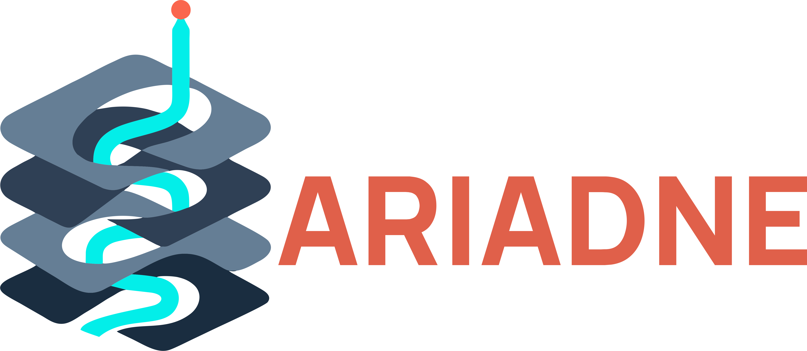

<p align="center">
  
</p>

# ARIADNE

Локальная система для работы с научной литературой о Nafion/PFSA и связанных аккумуляторных материалах. Сохраняет оригинальные PDF, извлекает текст по страницам, строит фрагменты с привязкой к источнику и предоставляет поиск, просмотр доказательств и ответы с цитатами.

Состояние сверено с исходниками **14 октября 2026 года**. Версия Python-пакета — `0.1.0`; концепция проекта `v1.1` в презентациях не является версией программного релиза. Рабочая директория исторически называется `Nafion-RAG`.

## Что реализовано

| Подсистема | Возможности в исходниках | Ограничения |
| --- | --- | --- |
| PDF ingestion | Импорт файла/папки через CLI, загрузка через UI/API, постоянные локальные библиотеки, очередь и worker | Нужны PostgreSQL, миграции и доступные файлы |
| Текст и источники | PyMuPDF, OCRmyPDF, оригинальный/OCR/выбранный текстовый слой, детерминированные чанки, контроль PDF и ссылки на страницы | Ошибки OCR, повреждённые глифы и сложная геометрия PDF остаются возможны |
| Retrieval | `exact`, `semantic`, `hybrid`, `hybrid_cross_lingual`, фильтры и группировка; локальные FastEmbed-векторы | Семантическим методам нужен индекс; ограничения группировки могут скрывать нужные фрагменты |
| Индекс | Состояния и поколения индекса, очередь пересборки, фоновая пересборка и очистка поколений | Готовность текста и готовность векторного индекса различаются |
| Ответы | OpenAI provider, проверка citation IDs, отказы по эвристике достаточности, mini-review по статьям | Цитата и прохождение эвристик не доказывают научную корректность утверждения |
| Числовые кандидаты | Извлечение, source/context diagnostics, аудит изменений и локальный review UI | Научное принятие извлечения и массовое обновление фактов остаются открытыми |
| Experimental records | Draft contract, точные source regions, manifests, проверка evidence integrity, review worksheets, локальный smoke и offline comparison | Development harness; автоматически принятые научные записи не реализованы |
| TAC и Terms | Экспериментальные скрипты извлечения Title/Abstract/Conclusions, метаданных, аудита границ и предложений терминов; HTML review | Не подключены к production indexing; результаты требуют review |

Внешний поиск метаданных и полноценный разговорный chat UI не реализованы. `GROBID_URL` и `ENABLE_EXTERNAL_METADATA_LOOKUP` в конфигурации сами по себе не подтверждают наличие работающей интеграции.

## Текущий экспериментальный статус

**Контекст stage08, 20 октября.** Offline prepass удаляет точные повторы страниц и предлагает исключение явно распознанных reference sections; неоднозначную библиографию сохраняет. На четырёх frozen-вопросах stage07 текст сократился на 16,36% по символам; на трёх положительных — на 22,86%. Проверены 35 точных срезов. Полные страницы остаются: новый opt-in guard блокирует кандидаты до API, новых GPT-вызовов нет. Это не измерение экономии токенов или качества ответа. 1 189 тестов прошли, Ruff/mypy — без ошибок. Подробнее: [stage08](docs/records_stage08_context_compaction_2026-10-20.md), [протокол](docs/records/context_compaction_protocol_v0.1.md). Локальный review: `output/records_stage08_20261020/replay_v02/review.html`. Далее — отдельная версия более узких окон с проверкой условий, подписей и сносок.

**Сквозной stage07, 20 октября.** Четыре frozen-вопроса прошли реальный `answer_question`: автоматический hybrid_cross_lingual поиск → отбор evidence → GPT → проверка citation IDs. Три ответа, один отказ gate без API; все 11 claims ссылаются на переданные источники, ожидаемые статьи найдены и процитированы в 3/3 положительных случаях. Это не научная accuracy. Выявлены библиографический шум, повреждённые формулы и отклонение от протокола: полные выбранные chunks содержат целые страницы. Восстановлены отсутствующие BGE-веса в кэше проекта; глобальный provider не переключён. 1 167 тестов прошли, Ruff/mypy — без ошибок. Подробнее: [stage07](docs/records_stage07_end_to_end_2026-10-20.md), [протокол](docs/records/end_to_end_protocol_v0.1.md). Локальный review: `output/records_stage07_20261020/review.html`.

**Блок 4, records stage06, 20 октября.** Новый `span_fixed` задаёт три именованных nullable linkage slots; дубли JSON-ключей отклоняются. Четыре реальные API-попытки integrity-valid: три кандидата и корректный bibliography negative. 82 coordinate references разрешились точно; по неизменному эталону 21 match, 5 mismatch, 34 deferred dimensions. Научная приёмка не закрыта. 1 155 тестов прошли, Ruff/mypy — без ошибок; stages02–05 воспроизведены. Подробнее: [stage06](docs/records_stage06_fixed_links_2026-10-20.md), [протокол](docs/records/fixed_link_slots_protocol_v0.1.md). Локальный review: `output/records_stage06_20261020/comparison.html`.

**Блок 4, records stage05, 20 октября.** Добавлены `span_full` / `span_compact`: GPT выбирает номера токенов, код восстанавливает исходный текст с точными координатами. Короткий случай — 4/4 exact raw fields. Таблица отклонена за повтор `conditions_measurement`; оставшиеся два запроса остановлены по протоколу. В двух сырых предложениях 53 coordinate references, все разрешились; это не научная приёмка. 1 138 тестов прошли, Ruff/mypy — без ошибок. Подробнее: [stage05](docs/records_stage05_token_spans_2026-10-20.md), [протокол](docs/records/token_span_protocol_v0.1.md). Локальный review: `output/records_stage05_20261020/comparison.html`.

**Блок 4, records stage04, 20 октября.** Добавлен отдельный OpenAI Responses backend; общий RAG provider не переключён. Четыре реальные попытки `gpt-6-astra`: три integrity-valid случая, включая корректный bibliography negative; таблица Sanginov отклонена из-за неточной цитаты. Короткий фрагмент: 4/4 exact raw fields вместо прежних 1/4. Полная научная запись не принята: reference остаётся development, есть mismatches/deferred dimensions. 1 120 тестов прошли, Ruff/mypy — без ошибок. Подробнее: [stage04](docs/records_stage04_openai_2026-10-20.md), [протокол](docs/records/openai_comparison_protocol_v0.1.md). Локальное сравнение: `output/records_stage04_20261020/comparison.html`.

**Блок 4, records stage03, 20 октября.** Отдельный compact wire запрашивает пять полей из одного frozen-фрагмента. Единственный реальный опыт завершился за 9.445 s, 64 output tokens; literal validation отклонила value/unit/temperature, кандидатов не создано. Одно из четырёх raw fields совпало, sample abstention сохранён; это не научная accuracy. Полный regression: 1 103 passed, Ruff/mypy прошли. Старый full wire остаётся default и воспроизвёл прежние результаты. Подробнее: [stage03](docs/records_stage03_compact_2026-10-20.md), [протокол](docs/records/compact_record_protocol_v0.1.md).

**Блок 4, records stage02, 20 октября.** Добавлены bounded adapter и evaluator полной записи: 16 полей, representation, три linkage roles, точные source anchors, отдельный учёт пропусков/отказов и HTML трёх development-случаев. Прежние TAC/Terms и source-only stage01 сохранены коммитами. Финальный regression: 1 090 passed, Ruff/mypy прошли. Все три реальные попытки Qwen2.5-3B на 2 CPU threads завершились timeout по 300 s; успешное extraction и научная accuracy не установлены. Исходные PDF и frozen reference сохранены. Подробнее: [stage02](docs/records_stage02_bounded_extraction_2026-10-20.md), [протокол/команды](docs/records/bounded_record_protocol_v0.1.md).

**Блок 4, records stage01: инициализация пилота Li-Nafion.** Исправлен состав source baseline: включены runtime JSON/JS/HTML/CSS. Новый read-only exporter сохраняет все 33 документа / 493 полные выбранные страницы, source hashes и отдельный лексический аудит. HTML содержит только источники, без предложений записей и аннотаций. Найдены шесть документов с Li-Nafion anchors; 10–15 научно пригодных публикаций и независимый эталон пока не установлены. Два экспорта воспроизвели source content; 1 054 tests, Ruff, mypy и offline browser QA прошли. Extractor и научная accuracy этим этапом не реализованы. Подробнее: [stage01](docs/records_stage01_initialization_2026-10-14.md), [протокол](docs/records/pilot_initialization_protocol_v0.1.md).

Основной pipeline ingestion → retrieval → ответы присутствует в коде. Октябрьские циклы отдельно исследуют experimental records и TAC; их номера этапов относятся к разным экспериментам.

**Experimental records, S01–S06.** Реализованы профиль Li-Nafion, контракт кандидатов, экспорт источников и сравнение сохранённых single-field ответов. Предварительный эталон содержит 3 development случая / 30 полей и имеет статус `needs_independent_review`. При повторной проверке сохранённых ответов 12 октября у Qwen2.5-1.5B и Qwen2.5-3B было по 3/30 совпадения с этим эталоном, все — отказы. Это не независимая оценка научной accuracy и не доказательство готовности автоматического extraction adapter. Разметка, связь sample/conditions/method/origin и научное принятие остаются открытыми. Подробнее: [план разработки](docs/ariadne_development_plan_2026-10-09.md), [S06 comparison](docs/ariadne_s06_reference_comparison_2026-10-09.md), [проверка сессии](docs/ariadne_session_review_2026-10-12.md).

**TAC, stages 05–08.** Проверены границы сохранённых предложений, исправлены два варианта административных stop headings, добавлены source-bound Terms proposals. Stage 08 восстановил обрезанный Conclusions Nagasubramanian: слово `results` внутри предложения больше не считается заголовком при подтверждённой геометрии строки. Текущие версии: `tac_section_proposals_v0.7` и `tac_term_candidates_v0.3`. Замороженный development snapshot содержит 33 документа, 493 выбранные страницы и 619 чанков, включая повторную загрузку Welch. В сохранённом результате stage 08: 377 предложений терминов / 1 087 точных evidence occurrences. Это количество результатов, не precision/recall. Ошибки границ и повреждённые исходные глифы сохраняются в диагностике; независимая точность 95% не подтверждена. Подробнее: [stage 05](docs/tac_stage05_boundary_audit_2026-10-12.md), [stage 06](docs/tac_stage06_stop_headings_2026-10-12.md), [stage 07](docs/tac_stage07_terms_2026-10-12.md), [stage 08](docs/tac_stage08_inline_stop_2026-10-13.md).

**TAC stage09, полный Terms inventory.** Новый explicit формат `tac_term_inventory_v0.1` сохраняет все 2 266 лексических кандидатов / 4 195 evidence occurrences существующего генератора, включая вложенные фразы. Превью 377 Terms совпадает со stage08; лимит 12 теперь относится только к показу в новом формате. Остальные кандидаты раскрываются группами по 50 и доступны поиску. Legacy v0.3 сохраняет прежний контракт и остаётся CLI default. Полный инвентарь не означает полноту научных понятий; классификация и научные связи ещё не реализованы. Подробнее: [stage09](docs/tac_stage09_inventory_2026-10-13.md), [contract](docs/terms_inventory_contract_v0.1.md), [план Terms](docs/terms_implementation_plan_2026-10-13.md).

**TAC stage10, упоминания и контексты.** Sidecar `tac_term_contexts_v0.1` связывает прежние Terms с 4 195 точными упоминаниями/употреблениями и 98 TAC-фрагментами страниц. Добавлены 3 635 лексических вложений по source offsets; они не означают синонимию, concept hierarchy или scientific relation. Повторные употребления и отдельные загрузки сохраняют свои IDs. Контексты раскрываются в HTML; роли и категории пока не назначены. Подробнее: [stage10](docs/tac_stage10_contexts_2026-10-13.md), [context contract](docs/terms_context_contract_v0.1.md).

**Terms Atlas, граф источников.** Локальный exporter `tac_terms_graph_v0.1` показывает все 33 статьи и 2 266 отдельных кандидатов из stage09/10. Круги статей и T/A/C-подмножеств имеют площадь, пропорциональную числу уникальных локальных term IDs; выбор term показывает его пересекающиеся группы, точные вхождения, полные контексты и исходный PDF. Группы структурные, научная классификация этапа 3 ещё не выполнена. Подробнее и команда экспорта: [Terms Atlas](docs/terms_graph_2026-10-13.md).

**TAC stage11, предложенная классификация и subsets.** Этап 3 добавляет draft taxonomy по типу/роли/происхождению и 12 585 source-bound assignments. Состояния `proposed`, `unclassified`, `unresolved` сохраняются отдельно; все 2 266 кандидатов и их источники сохранены. Граф v0.2 переключает оси, сортирует Terms и экспортирует subset; отдельная HTML-таблица сохраняет восемь колонок. Роль/происхождение демонстрируются восемью manual assistant proposals в одном abstract; научная приёмка не выполнена. 934 теста прошли. Подробнее: [stage11](docs/tac_stage11_classification_2026-10-13.md), [annotation guide](docs/terms_annotation_guide_v0.1.md).

**TAC stage12, постоянный review Terms.** Этап 4 добавляет отдельную SQLite-историю решений, подтверждение/исправление/отклонение/неопределённость, восстановление ревизий, очереди и проверку изменившихся источников. Граф пересчитывает subsets по решениям, сохраняя исходные предложения. Рабочий UI: `http://127.0.0.1:8766/ui/terms-review`; запуск: `.\.venv\Scripts\python.exe -m scripts.terms_review_server --root data/reviews/terms --port 8766`. Есть backup/restore и отдельная HTML-таблица всех 33 документов. 950 тестов прошли; reviewer заявляется пользователем, независимая научная приёмка остаётся открытой. Подробнее: [stage12](docs/tac_stage12_review_2026-10-13.md), [review contract](docs/terms_review_contract_v0.1.md).

**TAC stage13, автоматические Terms.** По запросу пользователя ручной workflow stage12 отключён: форма решений удалена, POST decision возвращает 410, старые решения остаются архивными и не меняют subsets. Default policy/sidecar v0.2 классифицируют точные употребления по контекстным правилам. Из 54 прежних конфликтов 46 получили автоматические предложения; восемь концентраций Doi остаются в диагностике без задания пользователю. На этом frozen input типы имеют 1 208 proposed / 2 979 unclassified / 8 unresolved; роль/происхождение остаются unknown. 957 tests, Ruff и mypy прошли. Встроенный браузер проверил Atlas и поиск таблицы; массовое раскрытие таблицы завершилось timeout. Подробнее: [stage13](docs/tac_stage13_automatic_2026-10-14.md), [automatic contract](docs/terms_automatic_contract_v0.2.md). UI и команда запуска используют прежний адрес/путь, теперь только для просмотра алгоритмических результатов.

**TAC stages14–16, 14 октября.** Массовое раскрытие HTML исправлено и проверено на всех 33 строках; источники Terms остаются ленивыми. Default taxonomy/sidecar v0.3 добавляет автоматические роли/происхождение: на frozen corpus 3 role proposals и 64 own-report proposals, остальные случаи остаются unknown. Отдельный автоматический пилот связей распознал 45 шаблонов: 7 proposed `property-of`, 38 deferred; корпусных `measured-by` предложений нет. Связи не меняют категории/subsets, не создают научного подтверждения и не требуют решений пользователя. 981 tests, Ruff, mypy и восстановление снимка прошли; production ingestion/retrieval не изменены. Подробнее: [stage14](docs/tac_stage14_table_expansion_2026-10-14.md), [stage15](docs/tac_stage15_context_roles_2026-10-14.md), [stage16](docs/tac_stage16_relation_pilot_2026-10-14.md), [context contract v0.3](docs/terms_automatic_contract_v0.3.md), [relation contract](docs/terms_relation_contract_v0.1.md).

**TAC stage17, полные названия и автоматическая пересборка.** Инвентарь v0.2 сохраняет прежние кандидаты и добавляет полные названия; default taxonomy/sidecar v0.4 различает методы и инструменты. Frozen corpus: 2 283 Terms / 4 214 uses; 36 role proposals, 65 origin proposals, 9 `property-of` и 2 `measured-by` proposals. Две связи NMR относятся к повторным загрузкам одной статьи Welch. Pipeline автоматически пересобирает результат при смене JSON snapshot/config/кода и сохраняет прежний снимок при ошибках; фоновый watcher включён с проверкой каждые 30 секунд. Прямая связь PostgreSQL ingestion → JSON snapshot не реализована. 990 tests, Ruff, mypy и проверка backup/restore прошли. Подробнее: [stage17](docs/tac_stage17_full_names_2026-10-14.md), [контракт](docs/terms_full_names_pipeline_contract_v0.1.md), [пример config](docs/terms_pipeline_config.example.json).

**TAC stage18, исправление границ v0.8.** Шесть известных ошибок границ и один пропуск исправлены по оригинальным PDF; остальные 92 поля TAC сохранены. Отдельная HTML-таблица включает все 33 документа, восемь колонок, прежние изменённые тексты и диагностику. Текущий автоматический снимок содержит 2 154 Terms / 3 976 uses; 475 article-local Terms имеют предложения type. Рекомендации диссертации исключены из C по явному контракту, исходный корпус сохранён. 1 022 tests, Ruff, mypy и проверки источников/API/HTML прошли. Метрики прежних 46 поисковых вопросов не изменились; независимая научная точность не установлена. Подробнее: [stage18](docs/tac_stage18_boundary_cleanup_2026-10-14.md), [контракт v0.8](docs/tac_boundary_cleanup_contract_v0.8.md).

**TAC stage19, новые открытые статьи и v0.9.** Отдельный корпус: восемь PDF (4 RU / 4 EN), 138 страниц. До первого запуска заморожены код v0.8 и source reference; совпали 14/24 полей T/A/C. Общие исправления v0.9 дали 24/24 на тех же входах, которые после исправлений являются development корпусом. Все 99 прежних полей TAC и 91 заполненное значение метаданных сохранены. Новые статьи содержат 462 Terms / 849 uses; в рабочую БД они не добавлены. Metadata заполнены в 13/24 полях, ошибки авторов остаются явными. 1 039 tests, Ruff, mypy и browser/source checks прошли. Независимая точность и retrieval efficacy не измерены. Подробнее: [stage19](docs/tac_stage19_holdout_result_2026-10-14.md), [контракт v0.9](docs/tac_boundary_cleanup_contract_v0.9.md).

Размер корпуса и результаты выше относятся к указанным сохранённым входам. Они не являются новым измерением состояния живой БД. Исторические retrieval и numeric audits доступны в [roadmap](docs/roadmap.md) и [аудите numeric occurrences](docs/stage3_numeric_occurrences_2026-09-14.md).

## Быстрый запуск

Нужны Python 3.11+, PostgreSQL и доступная локальная БД. Для сканированных PDF дополнительно нужны OCRmyPDF, Tesseract с языками из `OCR_LANGUAGES` и Ghostscript. Начальная конфигурация OCR использует `eng+rus`.

Из корня репозитория в PowerShell:

```powershell
python -m venv .venv
.\.venv\Scripts\python.exe -m pip install -e ".[dev]"
Copy-Item .env.example .env
```

Копируйте `.env.example` только при первоначальной настройке. В `.env` задайте `DATABASE_URL` для существующей БД и проверьте `DATA_ROOT`, OCR и параметры индекса. `.env` не хранится в Git.

```powershell
.\.venv\Scripts\python.exe -m alembic upgrade head
.\.venv\Scripts\python.exe -m app.ingestion.cli doctor
.\.venv\Scripts\python.exe -m uvicorn app.main:app --host 127.0.0.1 --port 8000
```

В другом терминале запустите worker:

```powershell
.\.venv\Scripts\python.exe -m app.workers.worker
```

Откройте [локальный dashboard](http://127.0.0.1:8000/ui/) или [API docs](http://127.0.0.1:8000/docs). После настройки окружения доступен Windows launcher `scripts/ARIADNE.cmd`.

`GET /health` возвращает состояние HTTP-приложения; он не заменяет `doctor` с проверкой БД, миграций, файлов и OCR. Подробности: [operations](docs/operations.md).

## Добавление PDF

```powershell
.\.venv\Scripts\python.exe -m app.ingestion.cli file data/inbox/example.pdf --collection literature
.\.venv\Scripts\python.exe -m app.ingestion.cli folder data/inbox --collection literature
```

`example.pdf` здесь — путь к вашему входному файлу. В UI доступны [загрузка](http://127.0.0.1:8000/ui/ingestion) и [локальные библиотеки](http://127.0.0.1:8000/ui/libraries). Добавьте папку через Add Library и запустите Scan Now. При `LIBRARY_SCAN_ENABLED=true` worker периодически сканирует включённые библиотеки.

Оригинальные PDF сохраняются отдельно и должны оставаться неизменными. OCR создаёт отдельный производный файл. У evidence сохраняются article, PDF path, страница/диапазон, source type, выбранный текстовый слой и исходный текст.

Статус ingestion `indexed` означает готовность article/page/chunk evidence в PostgreSQL. Семантический поиск зависит от отдельного состояния индекса.

## Поиск и векторный индекс

Для семантического поиска постройте поколение индекса:

```powershell
.\.venv\Scripts\python.exe -m app.retrieval.cli build-generation --collection literature
.\.venv\Scripts\python.exe -m app.retrieval.cli status --collection literature
```

Модель задаётся `EMBEDDING_MODEL`; начальное значение — `BAAI/bge-small-en-v1.5`. Первое использование может потребовать загрузки модели. При `VECTOR_AUTO_REBUILD_ENABLED=true` и `WORKER_ROLE=vector` или `all` пересборка запускается в фоне, а запросы на неё объединяются.

```powershell
Invoke-RestMethod 'http://127.0.0.1:8000/search?q=Li-Nafion&collection=literature&top_k=10&method=exact'
Invoke-RestMethod 'http://127.0.0.1:8000/search?q=proton%20transport&collection=literature&top_k=10&method=hybrid'
```

Доступны также `semantic` и `hybrid_cross_lingual`. Последний использует варианты запроса и доменный RU/EN glossary; это не гарантия универсального перевода или полноты retrieval. Группировку и число фрагментов на статью оценивайте на задаче: ограничения одного/двух чанков уже приводили к потере нужного evidence в audits.

## Ответы с цитатами

Поиск и просмотр источников доступны без ключа генерации. Для ответов через настраиваемый provider в `.env` нужны:

```dotenv
RAG_PROVIDER=openai
RAG_OPENAI_API_KEY=YOUR_API_KEY
RAG_OPENAI_MODEL=YOUR_MODEL
```

Provider отправляет вопрос и выбранные фрагменты настроенному OpenAI API endpoint. Таким образом, хранение и retrieval локальные, а этот путь генерации использует внешний сервис. Локальный model smoke для experimental records — отдельный harness.

```powershell
Invoke-RestMethod -Method Post -Uri http://127.0.0.1:8000/answer `
  -ContentType application/json `
  -Body '{"question":"Li-Nafion membrane lithiation protocol","method":"hybrid_cross_lingual","top_k":5,"answer_style":"mini_review"}'
```

[Answer UI](http://127.0.0.1:8000/ui/answer) показывает ответ/отказ и evidence. Проверка отбрасывает claims без цитат или с неизвестными evidence IDs. Mini-review группирует evidence по статье; citation markers ведут на исходную PDF-страницу. Эвристические проверки достаточности и контекста не устанавливают научную истинность или корректность каждой связи между утверждениями.

## Локальный TAC review

Основные колонки HTML: **Title, Authors, Journal, Year, Abstract, Conclusions, Terms, ссылка на исходный PDF**. Таблица содержит поиск, раскрытие полных текстов, source diagnostics и optional boundary assessments. Terms остаются предложениями с точными цитатами; score не является вероятностью корректности.

Для существующей рабочей копии итоговый stage10 HTML находится в `output/tac_stage10_20261013/ARIADNE_TAC_stage10_contexts_final_2026-10-13.html`. Прежние таблицы сохранены отдельно. Оригиналы, замороженные snapshots и отчёты с текстом литературы остаются локальными и не входят в Git. Свежий clone этих файлов не содержит. Рецепт контекстов и вывода stage10 — в [отчёте этапа](docs/tac_stage10_contexts_2026-10-13.md); команды ниже воспроизводят сохранённый stage07 в legacy v0.3 формате.

Повторная генерация по сохранённым локальным входам в **новые** файлы:

```powershell
.\.venv\Scripts\python.exe -m scripts.tac_terms --snapshot data/experiments/tac/20261012_v01/corpus.json --profiles data/experiments/tac/20261012_stage06/profiles_final.json --boundary-review data/experiments/tac/20261012_stage06/boundary_review_final.json --output output/tac_readme_replay/terms.json
.\.venv\Scripts\python.exe -m scripts.tac_review_html --snapshot data/experiments/tac/20261012_v01/corpus.json --profiles data/experiments/tac/20261012_stage06/profiles_final.json --metadata data/experiments/tac/20261012_stage06/metadata_final.json --boundary-review data/experiments/tac/20261012_stage06/boundary_review_final.json --terms output/tac_readme_replay/terms.json --output output/tac_readme_replay/review.html --source-root .
```

Скрипты отказываются перезаписывать существующие результаты. Sidecars связываются с snapshot/profiles через hashes и точные source spans. Проверка целостности не подтверждает научное решение рецензента. Полные рецепты и ограничения — в отчётах stages 05–07, перечисленных выше.

## Проверки и evaluation

```powershell
.\.venv\Scripts\python.exe -m ruff check app tests scripts
.\.venv\Scripts\python.exe -m mypy app
.\.venv\Scripts\python.exe -m pytest -q
```

На рабочей копии 13 октября 2026: **851 passed, 1 warning**, `ruff check` прошёл, `mypy app` — без ошибок в 84 source files. Warning — существующий `StarletteDeprecationWarning` об использовании httpx с Starlette TestClient. Полный pytest выполнен вне sandbox с новым `--basetemp` после задержки sandbox запуска; прерванному запуску успешный результат не приписывается. Эти проверки не заменяют live integration, независимый научный review или проверку установки в чистом окружении.

Evaluation на собственной настроенной БД и индексе:

```powershell
.\.venv\Scripts\python.exe -m app.evaluation.cli retrieval docs/evaluation_questions.yaml --top-k 10
.\.venv\Scripts\python.exe -m app.evaluation.cli retrieval-extended docs/evaluation_questions_extended.yaml --top-k 10 --method hybrid --check-thresholds
.\.venv\Scripts\python.exe -m app.evaluation.cli answers docs/evaluation_questions.yaml --top-k 5 --method hybrid
```

Answer evaluation использует настроенный provider. Новые live retrieval/model benchmarks при актуализации README не запускались. Данные development audits и агентские reference agreements нельзя выдавать за независимый gold.

## Навигация по репозиторию

| Путь | Назначение |
| --- | --- |
| `app/main.py`, `app/ui.py` | FastAPI и локальный HTML UI |
| `app/ingestion/`, `app/extraction/`, `app/chunking/` | PDF, текст/OCR и source-linked chunks |
| `app/library/`, `app/workers/` | Постоянные библиотеки и фоновые задачи |
| `app/retrieval/`, `app/generation/`, `app/evaluation/` | Поиск, ответы и evaluation |
| `app/facts/`, `app/records/` | Числовые кандидаты и experimental record harness |
| `scripts/tac_*.py` | Изолированные TAC/metadata/Terms эксперименты |
| `alembic/`, `tests/` | Миграции и тесты |
| `docs/`, `handoffs/` | Контракты, планы, отчёты и материалы передачи контекста |
| `presentations/` | Концепция проекта и презентации; не runtime приложения |

Границы научных утверждений и правила разработки: [AGENTS.md](AGENTS.md). Контракт experimental records: [experimental_record_contract.md](docs/records/experimental_record_contract.md). Локальные runtime logs, corpus exports в handoff-пакетах, содержащие их ZIP, промежуточные сборки и renders исключены из Git; исходники и готовые презентационные материалы сохраняются отдельно от приватного корпуса. Исторические handoff manifests описывают полные локальные пакеты, включая исключённые evidence/archives; clone не воспроизводит эти пакеты целиком. `presentations/ariadne-box-site/` — отдельный вложенный Git-репозиторий статической страницы, исключённый из Git ARIADNE.
