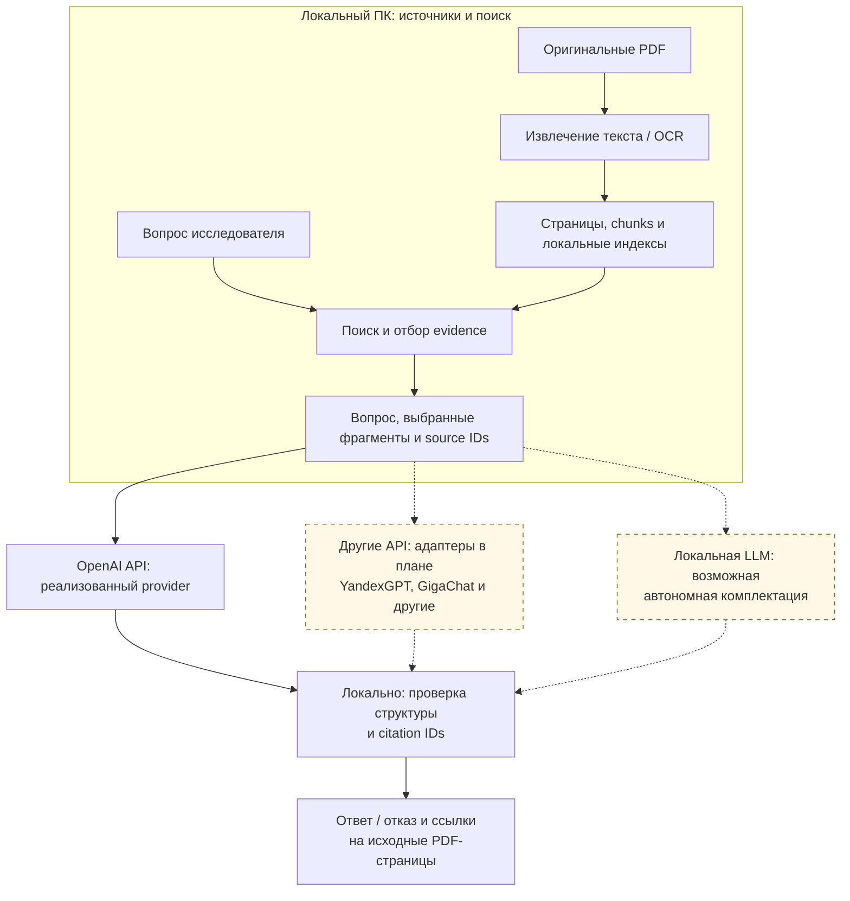

<p align="center">
  
</p>

# ARIADNE

Локальная система для работы с научной литературой о Nafion/PFSA и связанных аккумуляторных материалах. Сохраняет оригинальные PDF, извлекает текст по страницам, строит фрагменты с привязкой к источнику и предоставляет поиск, просмотр доказательств и ответы с цитатами.

Состояние сверено с исходниками **14 октября 2026 года**. Версия Python-пакета — `0.1.0`; концепция проекта `v1.1` в презентациях не является версией программного релиза. Рабочая директория исторически называется `Nafion-RAG`.

## Архитектура MVP и варианты анализа

Направление MVP зафиксировано **22 октября 2026 года**: локальное хранение, подготовка и поиск источников; анализ выбранного evidence через API; локальная проверка структуры ответа и ссылок. Сейчас runtime provider — `openai`. Подключение других LLM-провайдеров через адаптеры и автономная комплектация с локальной моделью остаются планом. [Память решения и ограничения](docs/mvp_inference_strategy_2026-10-22.md).



Сплошные связи показывают существующий базовый путь; пунктирные — варианты расширения. Диаграмма не означает, что полностатейное извлечение экспериментальных записей или научная проверка всех связей завершены. TAC/Terms и records experiments имеют отдельные стадии и ограничения.

Целевой пакет доказательств сохраняет исходные фрагменты и необходимый контекст: заголовки таблиц, единицы, сноски, условия и методику. Неопределённые случаи и `no_literal_cue` не должны исчезать из поиска. Проверка citation IDs не доказывает, что вывод модели научно следует из цитаты; новые провайдеры требуют собственного сравнения качества. Поддержку конкретного API заявляем после реализации и проверки адаптера.

Автономная коробка остаётся возможным вариантом поставки под подтверждённую потребность в закрытом контуре. Первый API-based MVP позволяет проверить полезность системы до доводки аппаратной комплектации; спрос, экономия времени и научная точность ещё требуют измерения.

## Что реализовано

| Подсистема | Возможности в исходниках | Ограничения |
| --- | --- | --- |
| PDF ingestion | Импорт файла/папки через CLI, загрузка через UI/API, постоянные локальные библиотеки, очередь и worker | Нужны PostgreSQL, миграции и доступные файлы |
| Текст и источники | PyMuPDF, OCRmyPDF, оригинальный/OCR/выбранный текстовый слой, детерминированные чанки, контроль PDF и ссылки на страницы | Ошибки OCR, повреждённые глифы и сложная геометрия PDF остаются возможны |
| Retrieval | `exact`, `semantic`, `hybrid`, `hybrid_cross_lingual`, фильтры и группировка; локальные FastEmbed-векторы | Семантическим методам нужен индекс; ограничения группировки могут скрывать нужные фрагменты |
| Индекс | Состояния и поколения индекса, очередь пересборки, фоновая пересборка и очистка поколений | Готовность текста и готовность векторного индекса различаются |
| Ответы | OpenAI provider, проверка citation IDs, отказы по эвристике достаточности, mini-review по статьям | Цитата и прохождение эвристик не доказывают научную корректность утверждения |
| Подготовка ответа | Отдельные `/answer/prepare` и `/ui/answer/prepare`: поиск, проверка уточнений, source/page diagnostics, весь выбранный текст и PDF-ссылки | Генерация отключена; grammar конечная, scientific acceptance отсутствует; существующий `/answer` остаётся отдельным путём |
| Контексты PDF-блоков | `/answer/prepare/blocks` и `/ui/answer/prepare/blocks`: целые блоки с окружением, условиями/guards и полным исходным baseline | Отложенные/невыбранные блоки сохранены; объединённое покрытие страниц и byte ceiling проверяются; генерации нет |
| Аудит рисков контекста | `/answer/prepare/blocks/risks` и `/ui/answer/prepare/blocks/risks`: точный текст окружения, PDF-ссылки, поиск и layout/visual диагностика | Удалённая геометрия не доказывает нерелевантность; прежние отказы и выбор сохранены; генерация отключена |
| Библиографические метаданные | Прежний TAC-извлекатель подключён к импорту, дубликатам и переотбору текста; `/ui/articles/{id}/bibliography` показывает точные цитаты и историю | Значения остаются предложениями алгоритма; существующие поля сохраняются, unknown/ambiguous не угадываются; нужна миграция 0006 |
| Числовые кандидаты | Извлечение, source/context diagnostics, аудит изменений и локальный review UI | Научное принятие извлечения и массовое обновление фактов остаются открытыми |
| Experimental records | Draft contract, точные source regions, manifests, проверка evidence integrity, review worksheets, локальный smoke и offline comparison | Development harness; автоматически принятые научные записи не реализованы |
| TAC и Terms | Экспериментальные скрипты Title/Abstract/Conclusions, аудита границ и предложений терминов; HTML review | TAC-разделы и Terms не подключены к production indexing; библиографический адаптер импорта описан отдельно |

Внешний поиск метаданных и полноценный разговорный chat UI не реализованы. `GROBID_URL` и `ENABLE_EXTERNAL_METADATA_LOOKUP` в конфигурации сами по себе не подтверждают наличие работающей интеграции.

## Текущий экспериментальный статус

**Records stage40, отбор контекста по вопросу, 24 октября.** Новый offline selection выбирает 142/561 блоков целыми группами; wire 200221 → 81189 байт, full-page occurrences 22 → 1. Это смена отбора: 116 старых окон сохранены целиком, 37 частично, 374 отложены; все полные parents/diagnostics побайтно сохранены локально. Пять protected groups отложены целиком — all-or-none не доказывает их научную ненужность. 11/11 development checks, 179 tests, Ruff/mypy и source/HTML/export QA прошли. Оставшийся Guo/SEI case показывает, что implicit sample/material scope ещё не проверяется; scientific loss не измерена, API admission 0/4. [Отчёт](docs/records_stage40_query_selection_2026-10-24.md), [протокол](docs/records/query_context_selection_protocol_v0.1.md). Review: `output/records_stage40_20261024/review_v01/review.html`; все десять TAC документов — соседний `metadata_review.html`. Далее — sample/material scope и source-based false-inclusion/exclusion checks; runtime/БД/PDF не менялись, новых retrieval/model calls нет.

**Records stage39, полнота контекста, 24 октября.** Новый offline audit объясняет все 22 полных страницы-вхождения объединением прежних окон: отдельных full-page windows нет, dependency closure блоков не добавляет. Проанализированы 1148 source-event occurrences и 449 зависимостей; поле подготовки в аргоне не переносится в измерение. Одна уникальная связка literal property/sample/method/condition повторяется в двух вопросах и остаётся предложением без sample identity/per-result applicability. 9/9 development checks, 170 tests, Ruff/mypy и HTML/export QA прошли. Прежние packets/diagnostics сохранены побайтно; API admission 0/4. [Отчёт](docs/records_stage39_context_completeness_2026-10-24.md), [протокол](docs/records/context_completeness_protocol_v0.1.md). Review: `output/records_stage39_20261024/review_v01/review.html`; все десять TAC документов — соседний `metadata_review.html`. Далее — отдельно оцениваемый query-aware selection с проверкой потерь; смена отбора не является lossless перепаковкой или scientific acceptance.

**Records stage38, компактный контекст, 24 октября.** Новый offline-формат уменьшил четыре model-facing JSON с 8156634 до 200221 байта; каждый укладывается в прежние 100000. Весь точный выбранный текст сохранён: 561 блок, 527 окон, 449 зависимостей; полные stage37 diagnostics скопированы побайтно. 125 tests, Ruff/mypy и повторный HTML/export QA прошли. Размер прошёл 4/4, допуск к API остаётся 0/4: прежние отказы и 22 случая сборки полной страницы сохранены. Runtime не подключён, обращений к БД/поиску/модели нет. [Отчёт](docs/records_stage38_compact_context_2026-10-24.md), [протокол](docs/records/compact_context_packet_protocol_v0.1.md). Review: `output/records_stage38_20261024/review_v01/review.html`; полная TAC-таблица всех десяти документов — соседний `metadata_review.html`. Далее — source-based полнота контекста и применимость условий; снижение bytes не доказывает экономию токенов или научное качество.

**Records stage37, пакет исходного контекста, 24 октября.** Отдельный локальный сборщик хранит точный блок один раз, восстанавливает все 527 исходных окон из 561 блока и сохраняет 19 baseline Evidence. Защищённые группы и незавершённые границы удерживают методику с её продолжением через блоки формулы; 6/6 development retention checks прошли. Это структурные зависимости, не подтверждённые научные связи. 94 tests, Ruff/mypy прошли. Дедупликация текста окон 354553 → 127532 байта не сделала wire пригодным для API: четыре пакета с полной диагностикой занимают 8156634 байта, каждый превышает прежний лимит; network-ready 0/4. Runtime, БД, PDF и provider не менялись, запросов к модели/поиску нет. [Отчёт](docs/records_stage37_source_context_packet_2026-10-24.md), [протокол](docs/records/source_context_packet_protocol_v0.1.md). Review: `output/records_stage37_20261023/review_v02/review.html`; полная TAC-таблица всех десяти документов — соседний `metadata_review.html`. Следующий шаг — компактное model-facing представление с полными локальными sidecars и проверкой exact coverage.

**Records stage36, оценка метаданных по источникам, 23 октября.** Проверены все 23 документа вне stage35; эталоны ассистента заморожены до новых предсказаний. Строгие совпадения: полные авторы 18/23, год 21/21 известных, журнал 16/21. Четыре отказа по авторам, один `III`/`111` из текстового слоя и пять расхождений точек/пробелов сохранены; пять journal mismatches не означают пять подмен журналов. Независимой человеческой приёмки нет; корпус ранее использовался в TAC-разработке. Алгоритм, БД и PDF не менялись. 76 tests, Ruff/mypy, HTML search/expansion и source/DB/replay проверки прошли. [Отчёт](docs/records_stage36_metadata_quality_2026-10-23.md), [протокол](docs/records/metadata_quality_protocol_v0.1.md). Review: `output/records_stage36_20261023/review_v01/review.html`. Следующий продуктовый шаг — подготовка контекста ответа; прежние blocked packets остаются заблокированными.

**Records stage35, подключение существующего извлекателя метаданных, 22 октября.** Прежний `tac_file_metadata_v0.1` теперь вызывается при импорте, повторном импорте и переотборе текста. Добавлены таблица истории происхождения и read-only API/UI с точными PDF/text/layer привязками; собственные автоматические значения обновляются, изменённые вручную сохраняются. В ограниченном scope из 10 статей заполнены 26 пустых полей: авторы 9/10, год 9/10, журнал 8/10. Это coverage предложений, не accuracy; Choi authors и Guo year/journal остались unknown. Остальные 23 статьи и данные вне метаданных не изменены. 2158 tests, Ruff/mypy прошли; новых retrieval/API generation calls нет. [Отчёт](docs/records_stage35_bibliography_bridge_2026-10-22.md), [протокол](docs/records/bibliography_bridge_protocol_v0.1.md). Review: `output/records_stage35_20261022/review_v01/review.html`. Перед запуском нового импортера применить `alembic upgrade head`.

**Records stage34, аудит в подготовке ответа, 22 октября.** Новый API/UI показывает stage33 audit рядом с полным прежним результатом подготовки: все 527 окон на 35 страницах-вхождениях, точный текст, PDF-ссылки, поиск и unknown diagnostics. На четырёх финальных реальных read-only API-запросах preparation полностью совпала со stage32, audit — со stage33; 0/4 network-ready, генеративных API-вызовов нет. Ссылка между режимами сохраняет явно выбранную библиотеку поверх другого cookie. 2134 tests, Ruff/mypy прошли. [Отчёт](docs/records_stage34_risk_preparation_2026-10-22.md), [протокол](docs/records/risk_preparation_protocol_v0.1.md). Review: `output/records_stage34_20261022/review_v01/review.html`. Далее — source-supported диагностика авторов/года из начала статьи с точными источниками; неизвестное не заполнять догадками.

**Records stage33, локализация рисков контекста, 22 октября.** Отдельный offline audit связывает layout/visual признаки с целыми блоками и защищённым окружением, включая отложенные страницы. На четырёх сохранённых результатах stage32: 527 диагностических окон, 1549 вхождений изображений/векторных объектов, 90 trigger records. Геометрическая удалённость не доказывает нерелевантность; 29 страниц-вхождений сохраняют нелокализованную диагностику. Объединения диагностических окон покрывают 22 страницы-вхождения, поэтому окна не превращаются в разрешённый пакет. Выбор и прежние отказы не изменены; новых retrieval/API calls нет. [Отчёт](docs/records_stage33_context_risks_2026-10-22.md), [протокол](docs/records/context_risks_protocol_v0.1.md). Review: `output/records_stage33_20261022/review_v01/review.html`. Следующий шаг — показать аудит в UI подготовки, сохранив прежний gate.

**Records stage32, контексты PDF-блоков, 22 октября.** Новый явный API/UI сохраняет baseline и предлагает целые зарегистрированные блоки с окружением, условиями и guards. Четыре реальных read-only запроса сохранили прежние 19 evidence; учтены 863 блока на 35 вхождениях страниц, 30 вхождений отложены. Получены 105 предложений для одного уже отклонённого вопроса; 0/4 пакета проходят все технические проверки. Новый union guard обнаружил три полные страницы в совокупности перекрывающихся окон, хотя буквальное сопоставление их не находило. 2062 tests, Ruff/mypy и два идентичных offline exports прошли. [Отчёт](docs/records_stage32_block_context_2026-10-22.md), [протокол](docs/records/block_context_protocol_v0.1.md). HTML: `output/records_stage32_20261022/review_v01/review.html`. Генерации нет, scientific accuracy не установлена. Далее — локальная привязка layout/visual risks к блокам и защищённому окружению по новому frozen protocol; запреты не ослаблять ради прохождения.

**Records stage31, режим подготовки ответа, 22 октября.** Новые API/UI показывают уточнения, отказы и source diagnostics до генерации. Четыре реальных read-only запроса к PostgreSQL дали те же 19 evidence, что stage29; все четыре заблокированы из-за полных страниц, qualifiers допускают только один. У выбранных статей неизвестны авторы/год в БД; guesses из текста не применялись. Генерации и внешних модельных запросов нет; локальные BGE query embeddings использовались. 2017 tests и Ruff/mypy прошли, два offline exports идентичны; [отчёт](docs/records_stage31_answer_preparation_2026-10-22.md), [протокол](docs/records/answer_preparation_protocol_v0.1.md). HTML: `output/records_stage31_20261022/review_v01/review.html`. Режим подключён явно, существующий `/answer` не менялся. Следующий bounded шаг — исходные блоки с сохранёнными условиями/отрицаниями и новое frozen comparison; полные страницы не обрезать ради прохождения guard. Source-supported заполнение метаданных остаётся отдельной задачей.

**Records stage30, обязательные уточнения запроса, 22 октября.** Отдельная versioned-проверка и injectable provider guard требуют явные material phrases, автор/год и finite method/property mentions внутри одной выбранной статьи. Неизвестные метаданные остаются unknown, упоминание в библиографии не подтверждает статью. На четырёх сохранённых контекстах допуск сократился с 3 до 1: Istomina/DSC и Mars/regolith блокируются, прежний отказ сохранён; все 19 evidence неизменны. 24/24 искусственных ожидания совпали; 1977 tests и Ruff/mypy прошли, это не независимая scientific accuracy. [Отчёт](docs/records_stage30_query_qualifiers_2026-10-22.md), [протокол](docs/records/query_qualifiers_protocol_v0.1.md). HTML: `output/records_stage30_20261022/run_v01/review.html`. Новых API/retrieval calls нет; production default и прежние thresholds не менялись. Следующий шаг — явный режим подготовки ответа с диагностикой новой проверки и отдельная оценка дополнительных вопросов. Упоминания не доказывают измерения; stage29 сохраняет 0/4 network eligible из-за полных страниц.

**Records stage29, пакет доказательств под запрос, 22 октября.** Отдельный сборщик сохраняет исходные evidence, точные source offsets и неопределённости. Четыре текущих контекста `answer_question` захвачены без генерации в read-only транзакции: все 19 evidence сохранены; две привязки относятся к одному отдельному контролю, transfer-привязок нет. Полные страницы остаются во всех пакетах: 0/4 допускаются к передаче API; сжатие и улучшение ответов не установлены. Проверка достаточности пропускает запросы с отсутствующими в совпадениях `Istomina/DSC` и `Mars/regolith`; правила после захвата не менялись. 1927 tests, Ruff/mypy, frozen hashes и два byte-identical exports прошли. [Отчёт](docs/records_stage29_query_packet_2026-10-22.md), [протокол](docs/records/query_packet_protocol_v0.1.md). HTML: `output/records_stage29_20261022/run_v01/review.html`. Новых generative API calls нет; локальные query embeddings использовались. Далее — отдельно замороженная проверка обязательных уточнений запроса и достаточности evidence до API-сравнения ответов. Production activation отсутствует.

**Records stage28, связь свойства и протокола через API, 22 октября.** Отдельный контракт выбирает source sentence IDs для свойства, метода и условий; native Responses adapter выполнен на всех четырёх cue-bearing блоках stage27 и отдельном контроле. Пять реальных вызовов, все 11 целей проходят структурную/source-integrity проверку. Категории API и локального baseline совпали на 6/7 transfer-целях и 4/4 контрольных; это agreement, не научная accuracy. DSC-протокол предложен как thermal_analysis; исходная mixed-role ambiguity и clipped unknown сохранены. Новых измерений и принятия записей нет. 1894 tests, Ruff/mypy, frozen hashes и два byte-identical offline exports прошли. [Отчёт](docs/records_stage28_protocol_association_2026-10-22.md), [протокол](docs/records/protocol_association_protocol_v0.1.md). HTML: `output/records_stage28_20261022/replay_v01/review.html`. Далее — source-preserving query evidence packet и отдельно оцениваемое сравнение контекстов ответа; origin и per-result applicability остаются непроверенными. Бюджет пяти live-вызовов исчерпан.

**Records stage27, RU/EN условия, 22 октября.** Новая отдельная frozen policy на прежних 52 страницах / 851 блоке дала пять source-scope proposals в трёх блоках; один cue-bearing блок сохранил отказ, 847 — no_literal_cue. Baseline/control воспроизведены точно. Отрицания, ссылки на чужую работу, модальность, обрезанные границы и смешанные роли сохраняют диагностику. Generic DSC measurement protocol не переносится на проводимость; applicability и scientific accuracy не установлены. 1854 tests, Ruff/mypy, frozen hashes и два byte-identical exports прошли. Новых измерений/model calls нет. [Отчёт](docs/records_stage27_condition_multilingual_2026-10-22.md), [протокол](docs/records/condition_multilingual_protocol_v0.1.md). HTML: `output/records_stage27_20261022/run_v01/review.html`; browser acceptance не проверена из-за запрета локального file://. Далее — отдельная source-only property/protocol association и независимая научная оценка.

**Records stage26, проверка переноса, 21 октября.** Frozen-правила stage25 проверены на всех 52 страницах / 851 блоке Sanginov с приложением и Istomina: **851 no_literal_cue**, распознанных transfer-событий нет. Отдельный контроль Каюмова воспроизвёл пять событий точно. Это ограничение узкой политики, не отсутствие условий в статьях и не научный recall. 2252 unsupported/incomplete события и прежние layout-диагностики сохранены; новых измерений/model calls нет. 1791 tests, Ruff/mypy, frozen hashes и два byte-identical exports прошли. [Отчёт](docs/records_stage26_condition_transfer_2026-10-21.md), [протокол](docs/records/condition_transfer_protocol_v0.1.md). HTML: `output/records_stage26_20261021/run_v01/review.html`. Далее — отдельная multilingual-версия scope policy и новое frozen-сравнение; независимый научный эталон остаётся открытым.

**Records stage25, подготовка и условия измерения, 21 октября.** Отдельный `records_condition_scope_v0.1` сохранил 37 версий / 42 позиции и различил 37 температур колонки, 33 метода и 31 режим охлаждения как source-scope предложения. Четыре выбранных слова «пластифицированной» остались unassigned; 43 пропуска сохранены. Пять фрагментов методики включают unsupported clause и обрезанный хвост; атмосфера подготовки не переносится в среду измерения. Применимость к каждому результату и достижение равновесия не установлены. Новых model calls нет. 1753 tests, Ruff/mypy, два побайтово одинаковых финальных экспорта и frozen hashes прошли. [Отчёт](docs/records_stage25_condition_scope_2026-10-21.md), [протокол](docs/records/condition_scope_protocol_v0.1.md). HTML: `output/records_stage25_20261021/run_v02/review.html`. Далее — проверка переноса правил на другие статьи по отдельно замороженному протоколу; независимая научная оценка остаётся открытой.

**Records stage24, роли состава и среды, 21 октября.** Отдельный `records_material_roles_v0.1` сохраняет все 37 версий / 42 source-позиции: 37 предложений компонентов пластификатора, 31 — его печатного состава, 37 — basis. Состав мембраны и среда измерения остаются unknown для всех версий. Исходные поля, шесть пропусков, parent report и три старых boundary findings сохранены; новых model calls нет. 1700 tests, Ruff/mypy, два побайтово одинаковых экспорта и source hashes прошли. [Отчёт](docs/records_stage24_material_roles_2026-10-21.md), [протокол](docs/records/material_roles_protocol_v0.1.md). HTML: `output/records_stage24_20261021/run_v01/review.html`. Далее — source-supported различение подготовки, кондиционирования и условий измерения; независимая научная оценка остаётся отдельной задачей.

**Records stage23, аудит связей, 21 октября.** Offline-аудит сохранил все 37 версий табличных кандидатов и 42 source-позиции; 13 native batches воспроизвелись точно. Координаты состава, basis, method cue и endpoint coverage проверены отдельно от научной семантики. Три отличия — полные заголовки «Смеси SL/EC/G2» против подстроки компонентов; это не научные error labels. Различия пяти полей у revisit сохранены без выбора «правильной» версии. Новых model calls нет. 1663 tests, Ruff/mypy, byte-identical export и source hashes прошли. [Отчёт](docs/records_stage23_table_relations_2026-10-21.md), [протокол](docs/records/table_relations_protocol_v0.1.md). HTML: `output/records_stage23_20261021/run_v01/review.html`. Семантика plasticiser/measurement medium и применимость метода остаются unknown.

**Records stage22, оставшиеся числовые позиции таблицы, 21 октября.** Восемь новых frozen Responses-вызовов дали 23 source-bound кандидата без пропусков целей. Вместе с прежними покрыты 36/36 числовых позиций ledger; четыре shared-позиции строк 12–13 unresolved, два тире сохранены. Все 23 новых кандидата технически complete и unreviewed; научная точность не измерена. 1632 tests, Ruff/mypy, двойной raw replay и source hashes прошли. [Отчёт](docs/records_stage22_table_remaining_2026-10-21.md), [протокол и бюджет](docs/records/table_remaining_protocol_v0.1.md). HTML: `output/records_stage22_20261021/live_v01/ledger.html` и `review.html`. История stage20/21 сохранена; научное принятие и полнота статей не заявлены.

**Records stage21, продолжение таблицы и method evidence, 21 октября.** Source ledger учитывает 42 позиции: 36 числовых, 2 тире, 4 unresolved для общих ячеек строк 12–13. Четыре новых frozen Responses-вызова дали 9 новых кандидатов и 1 повтор старой позиции с точным same-article method evidence. Покрыты 13 числовых позиций, остаются 23; повтор второй раз не посчитан. Восемь новых кандидатов технически complete, два сохраняют missing composition; все unreviewed, научная точность не измерена. 1593 tests, Ruff/mypy, offline raw replay и source hashes прошли. [Отчёт](docs/records_stage21_table_continuation_2026-10-21.md), [протокол](docs/records/table_continuation_protocol_v0.1.md). HTML: `output/records_stage21_20261021/live_v01/ledger.html` и `review.html`. Stage20 и review store сохранены; полного извлечения таблицы/статей нет.

**Records stage20, multi-record contract и реальный smoke, 21 октября.** Отдельный формат возвращает до четырёх записей с обязательным `partial`/unresolved при достижении лимита. Выполнены четыре замороженных Responses-вызова `gpt-6-astra`: 2 + 2 + 0 + 4 кандидата, все ответы exact-source-valid. Abstract и таблица остаются partial; cited origin сохранён, методы не породили значение. Все восемь кандидатов технически incomplete; научная точность и полнота не измерены. 1559 tests, Ruff/mypy прошли; offline raw replay совпал по records/regions/unresolved. Прежние форматы и review store не менялись. [Отчёт](docs/records_stage20_multi_record_2026-10-21.md), [протокол и лимиты](docs/records/multi_record_protocol_v0.1.md). Review: `output/records_stage20_20261021/live_v01/review.html`. Нового массового прогона 352 контекстов нет.

**Records stage19, bounded-контексты полного scope, 21 октября.** Offline planner учёл все 62 страницы / 1112 блоков трёх article tasks с supplement. Получены 352 source-only bounded-контекста; 34 страницы с неразрешённой структурой и один контекст полной страницы оставлены в явной диагностике. Сохранены 14 layout/table proposals и 107 растровых вхождений без утверждений о научной полноте. Два экспорта побайтово совпали; 1530 tests, Ruff/mypy прошли, три исходные страницы визуально проверены. Модельных вызовов и извлечённых измерений нет: прежний adapter ограничен одной записью на запрос. Следующий этап — отдельный multi-record contract и затем frozen model run. [Отчёт](docs/records_stage19_article_windows_2026-10-21.md), [протокол](docs/records/article_windows_protocol_v0.1.md). Review: `output/records_stage19_20261021/run_v01/review.html`.

**Records stage18, scope полных статей, 21 октября.** Подготовлены source-bound предложения отбора и три development task packets: Каюмов 2021, Sanginov 2021 и Istomina 2021; supplement Sanginov приложен отдельно по предложенной связи с exact evidence с обеих сторон. Пакеты учитывают все 62 страницы четырёх PDF, без top-k отбора и новых модельных вызовов. Все 33 документа / 493 сохранённых текста страниц остаются в отдельной поисковой HTML-таблице; 27 документов имеют unresolved screening. Два экспорта побайтово совпали. Это подготовка article-level extraction, не выполненное извлечение, независимый gold или достижение цели 10–15 пригодных публикаций. [Отчёт](docs/records_stage18_article_scope_2026-10-21.md), [протокол](docs/records/article_scope_protocol_v0.1.md). Локальный review: `output/records_stage18_20261021/run_v01/review.html`.

**Records stage17, backup/restore и чистый запуск, 20 октября.** Добавлен backup отдельного SQLite review store с точным контекстом, PDF-копиями и обязательной сверкой manifest checksum. Рабочие три записи и demo-история двух правок восстановлены в новые каталоги; состояния/экспорты совпали. Из frozen source в новом окружении: 1479 tests passed, HTTP-запуск API и восстановленного редактора, 18 PDF responses с проверкой хешей. Это восстановление на том же компьютере при сохранённых исторических путях PDF; PostgreSQL/весь корпус, offline inference и независимый научный пилот ещё не приняты. [Отчёт и ограничения](docs/records_stage17_recovery_2026-10-20.md), [команды backup/restore](docs/records/backup_recovery_protocol_v0.1.md).

**Records stage16, подготовка независимого пилота, 20 октября.** Проверены 33 документа / 493 source pages старого development packet; шесть lexical candidates не означают пригодные публикации. Новый evaluator сопоставляет несколько записей один-к-одному, сохраняет дубли/потери/неопределённость и не выдаёт итоговые precision/recall при missing/deferred reference. На прежних четырёх случаях raw replay сохранён, 34 deferred dimensions остаются; новых научных метрик нет. 1463 tests, Ruff/mypy прошли; matching дополнительно проверен на 1024 искусственных графах. Независимого участника пока нет, human time не измерено. [Отчёт и протокол](docs/records_stage16_pilot_preparation_2026-10-20.md).

**Records stage15, история и редактор, 20 октября.** Отдельный локальный UI хранит полные ревизии записей и решения reviewer в SQLite, проверяет expected_revision/source/code context и позволяет редактировать поля/evidence/связи, восстанавливать прежнее содержимое и экспортировать JSON/CSV. Кандидаты остаются needs_review; решения человека — отдельные явно заявленные статусы. 1431 tests, Ruff/mypy прошли; сохранение/перезапуск/restore проверены, browser подтвердил переключение полей и evidence. [Редактор](http://127.0.0.1:8767/), [отчёт и запуск](docs/records_stage15_revisions_2026-10-20.md). Независимая научная оценка остаётся открытой.

**Records stage14, проверки и сравнительный экспорт, 20 октября.** Offline CLI `python -m scripts.records_table` проверяет точные evidence/PDF hashes и формирует HTML/CSV/JSON из объявленных сохранённых bundles. На всех четырёх входах stage06: три записи, две неполные, одна unresolved; пустой вход сохранён. Все записи остаются needs_review, scientific admission не установлена. Повторные экспорты побайтово совпали; 1394 tests, Ruff/mypy прошли. История исправлений, независимая оценка и полный offline extraction остаются открытыми. [Отчёт](docs/records_stage14_checks_export_2026-10-20.md), [протокол](docs/records/checks_export_protocol_v0.1.md).

**Локальный OCR областей stage13, 20 октября.** Отдельный offline CLI распознаёт точные frozen-регионы в копиях PNG, сохраняя raw TXT/TSV, координаты слов, confidence и диагностику процесса. На четырёх областях текст получен в трёх; схема и таблицы содержат пропуски химических обозначений, чисел и единиц даже при высоком confidence. Все четыре PNG/TXT/TSV побайтово совпали при повторе, stage12 report неизменен. 1 336 тестов пройдено, Ruff/mypy без ошибок; четыре исходных crop и наложения просмотрены. Кандидаты в ответы не добавляются, GPT не вызывался. [Отчёт](docs/records_stage13_region_ocr_2026-10-20.md), [протокол](docs/records/region_ocr_protocol_v0.1.md). Review: `output/records_stage13_20261020/run_v01/review.html`, визуальные замечания: `visual_review_v02.html`.

**Графические пробелы stage12, 20 октября.** Новый opt-in `--source-gaps` сохраняет все растровые вхождения и векторные записи выбранных PDF с точными source/line/citation diagnostics. На 35 регистрациях (32 уникальные страницы) найдено 83 растровых вхождения; у 71 нет пересечения с зарегистрированными строками. Это не число потерянных научных фактов: логотипы, графики и неизвестное содержимое не классифицируются автоматически. Отбор и запросы stage11 остались прежними; stages08–11 reports byte-identical. 1 301 тест пройден, Ruff/mypy без ошибок, четыре PNG наложения просмотрены. OCR и новые GPT-вызовы не выполнялись. [Отчёт](docs/records_stage12_source_gaps_2026-10-20.md), [протокол](docs/records/source_gaps_protocol_v0.1.md). Review: `output/records_stage12_20261020/replay_v02/source_gap_review.html` и `source_gap_visual_review.html`.

**Реальные таблицы stage11, 20 октября.** Добавлен opt-in режим по замкнутым горизонтальным PDF-линейкам и точным text blocks. В v0.1 визуальный аудит нашёл пропущенную последнюю строку/буквенную сноску; запуск сохранён как отклонённый. Исправленная v0.2 оставляет две визуально проверенные табличные группы, включая четырёхстрочные температурные сноски; неполный случай получает `table_tail_unresolved`. Новые 21 тест включают два реально воспроизведённых сбоя до исправления; полная регрессия — 1 274 passed, Ruff/mypy без ошибок. Положительные контексты короче ещё на 1 244 символа относительно stage10; это не accuracy или экономия токенов. Полные страницы ещё блокируют отправку, новых GPT-вызовов нет. Предыдущие stages08–10 reports byte-identical. [Отчёт](docs/records_stage11_ruled_tables_2026-10-20.md), [протокол v0.2](docs/records/ruled_tables_protocol_v0.2.md). Review: `output/records_stage11_20261020/replay_v02/table_review.html`.

**Группы контекста stage10, 20 октября.** Новый opt-in режим защищает целые группы подписей/строк/сносок с контекстом по PDF geometry; прежние stages08/09 reports воспроизведены byte-for-byte. В реальном replay получены предложения для двух рисунков и одной ссылки внутри абзаца; таблицы остаются неразрешёнными. Выигрыш мал: только 64 дополнительных символа на положительных вопросах. Postflight обнаружил 99,25% сохранённого текста одной страницы и изображение схемы, отсутствующее в зарегистрированном тексте. Полные страницы ещё блокируют отправку; новых GPT-вызовов нет. 1 253 теста прошли, Ruff/mypy — без ошибок; три PNG наложения просмотрены. [Отчёт](docs/records_stage10_layout_groups_2026-10-20.md), [протокол](docs/records/layout_groups_protocol_v0.1.md). Review: `output/records_stage10_20261020/replay_v01/layout_review.html`. Далее — диагностика графических source gaps и реальные табличные границы; scientific acceptance открыта.

**Окна контекста stage09, 20 октября.** Новый opt-in режим выбирает целые PDF text blocks с точными координатами, условиями измерений и соседними блоками. На тех же трёх положительных вопросах контекст короче на 29,44% относительно stage07; проверены 42 среза и 35 page/block registrations. Таблицы, рисунки и повреждённые формулы дают 28 широких fallback; полные страницы остаются, guard запрещает отправку. Новых GPT-вызовов нет. Default stage08 replay совпал полностью. 1 229 тестов прошли, Ruff/mypy — без ошибок. Подробнее: [stage09](docs/records_stage09_context_windows_2026-10-20.md), [протокол](docs/records/context_windows_protocol_v0.1.md). Review: `output/records_stage09_20261020/replay_v01/review.html`. Следующая задача — границы таблиц/рисунков/сносок и продолжения между страницами; scientific acceptance открыта.

**Контекст stage08, 20 октября.** Offline prepass удаляет точные повторы страниц и предлагает исключение явно распознанных reference sections; неоднозначную библиографию сохраняет. На четырёх frozen-вопросах stage07 текст сократился на 16,36% по символам; на трёх положительных — на 22,86%. Проверены 35 точных срезов. Полные страницы остаются: новый opt-in guard блокирует кандидаты до API, новых GPT-вызовов нет. Это не измерение экономии токенов или качества ответа. 1 189 тестов прошли, Ruff/mypy — без ошибок. Подробнее: [stage08](docs/records_stage08_context_compaction_2026-10-20.md), [протокол](docs/records/context_compaction_protocol_v0.1.md). Локальный review: `output/records_stage08_20261020/replay_v02/review.html`. Далее — отдельная версия более узких окон с проверкой условий, подписей и сносок.

**Сквозной stage07, 20 октября.** Четыре frozen-вопроса прошли реальный `answer_question`: автоматический hybrid_cross_lingual поиск → отбор evidence → GPT → проверка citation IDs. Три ответа, один отказ gate без API; все 11 claims ссылаются на переданные источники, ожидаемые статьи найдены и процитированы в 3/3 положительных случаях. Это не научная accuracy. Выявлены библиографический шум, повреждённые формулы и отклонение от протокола: полные выбранные chunks содержат целые страницы. Восстановлены отсутствующие BGE-веса в кэше проекта; глобальный provider не переключён. 1 167 тестов прошли, Ruff/mypy — без ошибок. Подробнее: [stage07](docs/records_stage07_end_to_end_2026-10-20.md), [протокол](docs/records/end_to_end_protocol_v0.1.md). Локальный review: `output/records_stage07_20261020/review.html`.

**Блок 4, records stage06, 20 октября.** Новый `span_fixed` задаёт три именованных nullable linkage slots; дубли JSON-ключей отклоняются. Четыре реальные API-попытки integrity-valid: три кандидата и корректный bibliography negative. 82 coordinate references разрешились точно; по неизменному эталону 21 match, 5 mismatch, 34 deferred dimensions. Научная приёмка не закрыта. 1 155 тестов прошли, Ruff/mypy — без ошибок; stages02–05 воспроизведены. Подробнее: [stage06](docs/records_stage06_fixed_links_2026-10-20.md), [протокол](docs/records/fixed_link_slots_protocol_v0.1.md). Локальный review: `output/records_stage06_20261020/comparison.html`.

**Блок 4, records stage05, 20 октября.** Добавлены `span_full` / `span_compact`: GPT выбирает номера токенов, код восстанавливает исходный текст с точными координатами. Короткий случай — 4/4 exact raw fields. Таблица отклонена за повтор `conditions_measurement`; оставшиеся два запроса остановлены по протоколу. В двух сырых предложениях 53 coordinate references, все разрешились; это не научная приёмка. 1 138 тестов прошли, Ruff/mypy — без ошибок. Подробнее: [stage05](docs/records_stage05_token_spans_2026-10-20.md), [протокол](docs/records/token_span_protocol_v0.1.md). Локальный review: `output/records_stage05_20261020/comparison.html`.

**Блок 4, records stage04, 20 октября.** Добавлен отдельный OpenAI Responses backend; общий RAG provider не переключён. Четыре реальные попытки `gpt-6-astra`: три integrity-valid случая, включая корректный bibliography negative; таблица Sanginov отклонена из-за неточной цитаты. Короткий фрагмент: 4/4 exact raw fields вместо прежних 1/4. Полная научная запись не принята: reference остаётся development, есть mismatches/deferred dimensions. 1 120 тестов прошли, Ruff/mypy — без ошибок. Подробнее: [stage04](docs/records_stage04_openai_2026-10-20.md), [протокол](docs/records/openai_comparison_protocol_v0.1.md). Локальное сравнение: `output/records_stage04_20261020/comparison.html`.

**Блок 4, records stage03, 20 октября.** Отдельный compact wire запрашивает пять полей из одного frozen-фрагмента. Единственный реальный опыт завершился за 9.445 s, 64 output tokens; literal validation отклонила value/unit/temperature, кандидатов не создано. Одно из четырёх raw fields совпало, sample abstention сохранён; это не научная accuracy. Полный regression: 1 103 passed, Ruff/mypy прошли. Старый full wire остаётся default и воспроизвёл прежние результаты. Подробнее: [stage03](docs/records_stage03_compact_2026-10-20.md), [протокол](docs/records/compact_record_protocol_v0.1.md).

**Блок 4, records stage02, 20 октября.** Добавлены bounded adapter и evaluator полной записи: 16 полей, representation, три linkage roles, точные source anchors, отдельный учёт пропусков/отказов и HTML трёх development-случаев. Прежние TAC/Terms и source-only stage01 сохранены коммитами. Финальный regression: 1 090 passed, Ruff/mypy прошли. Все три реальные попытки Qwen2.5-3B на 2 CPU threads завершились timeout по 300 s; успешное extraction и научная accuracy не установлены. Исходные PDF и frozen reference сохранены. Подробнее: [stage02](docs/records_stage02_bounded_extraction_2026-10-20.md), [протокол/команды](docs/records/bounded_record_protocol_v0.1.md).

**Блок 4, records stage01: инициализация пилота Li-Nafion.** Исправлен состав source baseline: включены runtime JSON/JS/HTML/CSS. Новый read-only exporter сохраняет все 33 документа / 493 полные выбранные страницы, source hashes и отдельный лексический аудит. HTML содержит только источники, без предложений записей и аннотаций. Найдены шесть документов с Li-Nafion anchors; 10–15 научно пригодных публикаций и независимый эталон пока не установлены. Два экспорта воспроизвели source content; 1 054 tests, Ruff, mypy и offline browser QA прошли. Extractor и научная accuracy этим этапом не реализованы. Подробнее: [stage01](docs/records_stage01_initialization_2026-10-14.md), [протокол](docs/records/pilot_initialization_protocol_v0.1.md).

Основной pipeline ingestion → retrieval → ответы присутствует в коде. Октябрьские циклы отдельно исследуют experimental records и TAC; их номера этапов относятся к разным экспериментам.

**Experimental records, S01–S06.** Реализованы профиль Li-Nafion, контракт кандидатов, экспорт источников и сравнение сохранённых single-field ответов. Предварительный эталон содержит 3 development случая / 30 полей и имеет статус `needs_independent_review`. При повторной проверке сохранённых ответов 12 октября у Qwen2.5-1.5B и Qwen2.5-3B было по 3/30 совпадения с этим эталоном, все — отказы. Это не независимая оценка научной accuracy и не доказательство готовности автоматического extraction adapter. Разметка, связь sample/conditions/method/origin и научное принятие остаются открытыми. Подробнее: [план разработки](docs/ariadne_development_plan_2026-10-09.md), [S06 comparison](docs/ariadne_s06_reference_comparison_2026-10-09.md), [проверка сессии](docs/ariadne_session_review_2026-10-12.md).

**TAC, stages 05–08.** Проверены границы сохранённых предложений, исправлены два варианта административных stop headings, добавлены source-bound Terms proposals. Stage 08 восстановил обрезанный Conclusions Nagasubramanian: слово `results` внутри предложения больше не считается заголовком при подтверждённой геометрии строки. Текущие версии: `tac_section_proposals_v0.7` и `tac_term_candidates_v0.3`. Замороженный development snapshot содержит 33 документа, 493 выбранные страницы и 619 чанков, включая повторную загрузку Welch. В сохранённом результате stage 08: 377 предложений терминов / 1 087 точных evidence occurrences. Это количество результатов, не precision/recall. Ошибки границ и повреждённые исходные глифы сохраняются в диагностике; независимая точность 95% не подтверждена. Подробнее: [stage 05](docs/tac_stage05_boundary_audit_2026-10-12.md), [stage 06](docs/tac_stage06_stop_headings_2026-10-12.md), [stage 07](docs/tac_stage07_terms_2026-10-12.md), [stage 08](docs/tac_stage08_inline_stop_2026-10-13.md).

**TAC stage09, полный Terms inventory.** Новый explicit формат `tac_term_inventory_v0.1` сохраняет все 2 266 лексических кандидатов / 4 195 evidence occurrences существующего генератора, включая вложенные фразы. Превью 377 Terms совпадает со stage08; лимит 12 теперь относится только к показу в новом формате. Остальные кандидаты раскрываются группами по 50 и доступны поиску. Legacy v0.3 сохраняет прежний контракт и остаётся CLI default. Полный инвентарь не означает полноту научных понятий; классификация и научные связи ещё не реализованы. Подробнее: [stage09](docs/tac_stage09_inventory_2026-10-13.md), [contract](docs/terms_inventory_contract_v0.1.md), [план Terms](docs/terms_implementation_plan_2026-10-13.md).

**TAC stage10, упоминания и контексты.** Sidecar `tac_term_contexts_v0.1` связывает прежние Terms с 4 195 точными упоминаниями/употреблениями и 98 TAC-фрагментами страниц. Добавлены 3 635 лексических вложений по source offsets; они не означают синонимию, concept hierarchy или scientific relation. Повторные употребления и отдельные загрузки сохраняют свои IDs. Контексты раскрываются в HTML; роли и категории пока не назначены. Подробнее: [stage10](docs/tac_stage10_contexts_2026-10-13.md), [context contract](docs/terms_context_contract_v0.1.md).

**Terms Atlas, граф источников.** Локальный exporter `tac_terms_graph_v0.1` показывает все 33 статьи и 2 266 отдельных кандидатов из stage09/10. Круги статей и T/A/C-подмножеств имеют площадь, пропорциональную числу уникальных локальных term IDs; выбор term показывает его пересекающиеся группы, точные вхождения, полные контексты и исходный PDF. Группы структурные, научная классификация этапа 3 ещё не выполнена. Подробнее и команда экспорта: [Terms Atlas](docs/terms_graph_2026-10-13.md).

**TAC stage11, предложенная классификация и subsets.** Этап 3 добавляет draft taxonomy по типу/роли/происхождению и 12 585 source-bound assignments. Состояния `proposed`, `unclassified`, `unresolved` сохраняются отдельно; все 2 266 кандидатов и их источники сохранены. Граф v0.2 переключает оси, сортирует Terms и экспортирует subset; отдельная HTML-таблица сохраняет восемь колонок. Роль/происхождение демонстрируются восемью manual assistant proposals в одном abstract; научная приёмка не выполнена. 934 теста прошли. Подробнее: [stage11](docs/tac_stage11_classification_2026-10-13.md), [annotation guide](docs/terms_annotation_guide_v0.1.md).

**TAC stage12, постоянный review Terms.** Этап 4 добавляет отдельную SQLite-историю решений, подтверждение/исправление/отклонение/неопределённость, восстановление ревизий, очереди и проверку изменившихся источников. Граф пересчитывает subsets по решениям, сохраняя исходные предложения. Рабочий UI: `http://127.0.0.1:8766/ui/terms-review`; запуск: `.\.venv\Scripts\python.exe -m scripts.terms_review_server --root data/reviews/terms --port 8766`. Есть backup/restore и отдельная HTML-таблица всех 33 документов. 950 тестов прошли; reviewer заявляется пользователем, независимая научная приёмка остаётся открытой. Подробнее: [stage12](docs/tac_stage12_review_2026-10-13.md), [review contract](docs/terms_review_contract_v0.1.md).

**TAC stage13, автоматические Terms.** По запросу пользователя ручной workflow stage12 отключён: форма решений удалена, POST decision возвращает 410, старые решения остаются архивными и не меняют subsets. Default policy/sidecar v0.2 классифицируют точные употребления по контекстным правилам. Из 54 прежних конфликтов 46 получили автоматические предложения; восемь концентраций Doi остаются в диагностике без задания пользователю. На этом frozen input типы имеют 1 208 proposed / 2 979 unclassified / 8 unresolved; роль/происхождение остаются unknown. 957 tests, Ruff и mypy прошли. Встроенный браузер проверил Atlas и поиск таблицы; массовое раскрытие таблицы завершилось timeout. Подробнее: [stage13](docs/tac_stage13_automatic_2026-10-14.md), [automatic contract](docs/terms_automatic_contract_v0.2.md). UI и команда запуска используют прежний адрес/путь, теперь только для просмотра алгоритмических результатов.

**TAC stages14–16, 14 октября.** Массовое раскрытие HTML исправлено и проверено на всех 33 строках; источники Terms остаются ленивыми. Default taxonomy/sidecar v0.3 добавляет автоматические роли/происхождение: на frozen corpus 3 role proposals и 64 own-report proposals, остальные случаи остаются unknown. Отдельный автоматический пилот связей распознал 45 шаблонов: 7 proposed `property-of`, 38 deferred; корпусных `measured-by` предложений нет. Связи не меняют категории/subsets, не создают научного подтверждения и не требуют решений пользователя. 981 tests, Ruff, mypy и восстановление снимка прошли; production ingestion/retrieval не изменены. Подробнее: [stage14](docs/tac_stage14_table_expansion_2026-10-14.md), [stage15](docs/tac_stage15_context_roles_2026-10-14.md), [stage16](docs/tac_stage16_relation_pilot_2026-10-14.md), [context contract v0.3](docs/terms_automatic_contract_v0.3.md), [relation contract](docs/terms_relation_contract_v0.1.md).

**TAC stage17, полные названия и автоматическая пересборка.** Инвентарь v0.2 сохраняет прежние кандидаты и добавляет полные названия; default taxonomy/sidecar v0.4 различает методы и инструменты. Frozen corpus: 2 283 Terms / 4 214 uses; 36 role proposals, 65 origin proposals, 9 `property-of` и 2 `measured-by` proposals. Две связи NMR относятся к повторным загрузкам одной статьи Welch. Pipeline автоматически пересобирает результат при смене JSON snapshot/config/кода и сохраняет прежний снимок при ошибках; фоновый watcher включён с проверкой каждые 30 секунд. Прямая связь PostgreSQL ingestion → JSON snapshot не реализована. 990 tests, Ruff, mypy и проверка backup/restore прошли. Подробнее: [stage17](docs/tac_stage17_full_names_2026-10-14.md), [контракт](docs/terms_full_names_pipeline_contract_v0.1.md), [пример config](docs/terms_pipeline_config.example.json).

**TAC stage18, исправление границ v0.8.** Шесть известных ошибок границ и один пропуск исправлены по оригинальным PDF; остальные 92 поля TAC сохранены. Отдельная HTML-таблица включает все 33 документа, восемь колонок, прежние изменённые тексты и диагностику. Текущий автоматический снимок содержит 2 154 Terms / 3 976 uses; 475 article-local Terms имеют предложения type. Рекомендации диссертации исключены из C по явному контракту, исходный корпус сохранён. 1 022 tests, Ruff, mypy и проверки источников/API/HTML прошли. Метрики прежних 46 поисковых вопросов не изменились; независимая научная точность не установлена. Подробнее: [stage18](docs/tac_stage18_boundary_cleanup_2026-10-14.md), [контракт v0.8](docs/tac_boundary_cleanup_contract_v0.8.md).

**TAC stage19, новые открытые статьи и v0.9.** Отдельный корпус: восемь PDF (4 RU / 4 EN), 138 страниц. До первого запуска заморожены код v0.8 и source reference; совпали 14/24 полей T/A/C. Общие исправления v0.9 дали 24/24 на тех же входах, которые после исправлений являются development корпусом. Все 99 прежних полей TAC и 91 заполненное значение метаданных сохранены. Новые статьи содержат 462 Terms / 849 uses; в рабочую БД они не добавлены. Metadata заполнены в 13/24 полях, ошибки авторов остаются явными. 1 039 tests, Ruff, mypy и browser/source checks прошли. Независимая точность и retrieval efficacy не измерены. Подробнее: [stage19](docs/tac_stage19_holdout_result_2026-10-14.md), [контракт v0.9](docs/tac_boundary_cleanup_contract_v0.9.md).

Размер корпуса и результаты выше относятся к указанным сохранённым входам. Они не являются новым измерением состояния живой БД. Исторические retrieval и numeric audits доступны в [roadmap](docs/roadmap.md) и [аудите numeric occurrences](docs/stage3_numeric_occurrences_2026-09-14.md).

## Быстрый запуск

Нужны Python 3.11+, PostgreSQL и доступная локальная БД. Для сканированных PDF дополнительно нужны OCRmyPDF, Tesseract с языками из `OCR_LANGUAGES` и Ghostscript. Начальная конфигурация OCR использует `eng+rus`.

Из корня репозитория в PowerShell:

```powershell
python -m venv .venv
.\.venv\Scripts\python.exe -m pip install -e ".[dev]"
Copy-Item .env.example .env
```

Копируйте `.env.example` только при первоначальной настройке. В `.env` задайте `DATABASE_URL` для существующей БД и проверьте `DATA_ROOT`, OCR и параметры индекса. `.env` не хранится в Git.

```powershell
.\.venv\Scripts\python.exe -m alembic upgrade head
.\.venv\Scripts\python.exe -m app.ingestion.cli doctor
.\.venv\Scripts\python.exe -m uvicorn app.main:app --host 127.0.0.1 --port 8000
```

В другом терминале запустите worker:

```powershell
.\.venv\Scripts\python.exe -m app.workers.worker
```

Откройте [локальный dashboard](http://127.0.0.1:8000/ui/) или [API docs](http://127.0.0.1:8000/docs). После настройки окружения доступен Windows launcher `scripts/ARIADNE.cmd`.

`GET /health` возвращает состояние HTTP-приложения; он не заменяет `doctor` с проверкой БД, миграций, файлов и OCR. Подробности: [operations](docs/operations.md).

## Добавление PDF

```powershell
.\.venv\Scripts\python.exe -m app.ingestion.cli file data/inbox/example.pdf --collection literature
.\.venv\Scripts\python.exe -m app.ingestion.cli folder data/inbox --collection literature
```

`example.pdf` здесь — путь к вашему входному файлу. В UI доступны [загрузка](http://127.0.0.1:8000/ui/ingestion) и [локальные библиотеки](http://127.0.0.1:8000/ui/libraries). Добавьте папку через Add Library и запустите Scan Now. При `LIBRARY_SCAN_ENABLED=true` worker периодически сканирует включённые библиотеки.

Оригинальные PDF сохраняются отдельно и должны оставаться неизменными. OCR создаёт отдельный производный файл. У evidence сохраняются article, PDF path, страница/диапазон, source type, выбранный текстовый слой и исходный текст.

Статус ingestion `indexed` означает готовность article/page/chunk evidence в PostgreSQL. Семантический поиск зависит от отдельного состояния индекса.

## Поиск и векторный индекс

Для семантического поиска постройте поколение индекса:

```powershell
.\.venv\Scripts\python.exe -m app.retrieval.cli build-generation --collection literature
.\.venv\Scripts\python.exe -m app.retrieval.cli status --collection literature
```

Модель задаётся `EMBEDDING_MODEL`; начальное значение — `BAAI/bge-small-en-v1.5`. Первое использование может потребовать загрузки модели. При `VECTOR_AUTO_REBUILD_ENABLED=true` и `WORKER_ROLE=vector` или `all` пересборка запускается в фоне, а запросы на неё объединяются.

```powershell
Invoke-RestMethod 'http://127.0.0.1:8000/search?q=Li-Nafion&collection=literature&top_k=10&method=exact'
Invoke-RestMethod 'http://127.0.0.1:8000/search?q=proton%20transport&collection=literature&top_k=10&method=hybrid'
```

Доступны также `semantic` и `hybrid_cross_lingual`. Последний использует варианты запроса и доменный RU/EN glossary; это не гарантия универсального перевода или полноты retrieval. Группировку и число фрагментов на статью оценивайте на задаче: ограничения одного/двух чанков уже приводили к потере нужного evidence в audits.

## Ответы с цитатами

Поиск и просмотр источников доступны без ключа генерации. Для ответов через настраиваемый provider в `.env` нужны:

```dotenv
RAG_PROVIDER=openai
RAG_OPENAI_API_KEY=YOUR_API_KEY
RAG_OPENAI_MODEL=YOUR_MODEL
```

Provider отправляет вопрос и выбранные фрагменты настроенному OpenAI API endpoint. Таким образом, хранение и retrieval локальные, а этот путь генерации использует внешний сервис. Локальный model smoke для experimental records — отдельный harness.

```powershell
Invoke-RestMethod -Method Post -Uri http://127.0.0.1:8000/answer `
  -ContentType application/json `
  -Body '{"question":"Li-Nafion membrane lithiation protocol","method":"hybrid_cross_lingual","top_k":5,"answer_style":"mini_review"}'
```

[Answer UI](http://127.0.0.1:8000/ui/answer) показывает ответ/отказ и evidence. Проверка отбрасывает claims без цитат или с неизвестными evidence IDs. Mini-review группирует evidence по статье; citation markers ведут на исходную PDF-страницу. Эвристические проверки достаточности и контекста не устанавливают научную истинность или корректность каждой связи между утверждениями.

Для проверки контекста без генерации используйте [подготовку ответа](http://127.0.0.1:8000/ui/answer/prepare) или POST `/answer/prepare` с теми же параметрами вопроса, поиска и библиотеки. Новый JSON имеет версию `answer_preparation_v0.1`: сохраняет весь evidence, причины блокировки, qualifier/source diagnostics и ссылки на оригиналы. Метаданные неизвестного автора/года не подменяются ссылкой из текста. Полные страницы и непроверенная привязка блокируют проверки; `network_ready=false` и `generation_performed=false` во всех результатах. Ключ генерации не нужен; поиск требует настроенной базы/индекса и локального embedding cache. Этот режим не заменяет существующий `/answer`.

Отдельный [режим PDF-блоков](http://127.0.0.1:8000/ui/answer/prepare/blocks), POST `/answer/prepare/blocks`, возвращает `query_block_context_v0.1`: неизменённый `baseline`, предложения целых блоков, учёт невыбранных/отложенных диапазонов и точные source regions. Проверяется не только отдельное окно, но и полное покрытие страницы всеми окнами вместе. `technical_checks_passed` не означает научную достаточность или разрешение отправки; `network_ready=false`, генерация отключена.

## Локальный TAC review

Основные колонки HTML: **Title, Authors, Journal, Year, Abstract, Conclusions, Terms, ссылка на исходный PDF**. Таблица содержит поиск, раскрытие полных текстов, source diagnostics и optional boundary assessments. Terms остаются предложениями с точными цитатами; score не является вероятностью корректности.

Для существующей рабочей копии итоговый stage10 HTML находится в `output/tac_stage10_20261013/ARIADNE_TAC_stage10_contexts_final_2026-10-13.html`. Прежние таблицы сохранены отдельно. Оригиналы, замороженные snapshots и отчёты с текстом литературы остаются локальными и не входят в Git. Свежий clone этих файлов не содержит. Рецепт контекстов и вывода stage10 — в [отчёте этапа](docs/tac_stage10_contexts_2026-10-13.md); команды ниже воспроизводят сохранённый stage07 в legacy v0.3 формате.

Повторная генерация по сохранённым локальным входам в **новые** файлы:

```powershell
.\.venv\Scripts\python.exe -m scripts.tac_terms --snapshot data/experiments/tac/20261012_v01/corpus.json --profiles data/experiments/tac/20261012_stage06/profiles_final.json --boundary-review data/experiments/tac/20261012_stage06/boundary_review_final.json --output output/tac_readme_replay/terms.json
.\.venv\Scripts\python.exe -m scripts.tac_review_html --snapshot data/experiments/tac/20261012_v01/corpus.json --profiles data/experiments/tac/20261012_stage06/profiles_final.json --metadata data/experiments/tac/20261012_stage06/metadata_final.json --boundary-review data/experiments/tac/20261012_stage06/boundary_review_final.json --terms output/tac_readme_replay/terms.json --output output/tac_readme_replay/review.html --source-root .
```

Скрипты отказываются перезаписывать существующие результаты. Sidecars связываются с snapshot/profiles через hashes и точные source spans. Проверка целостности не подтверждает научное решение рецензента. Полные рецепты и ограничения — в отчётах stages 05–07, перечисленных выше.

## Проверки и evaluation

```powershell
.\.venv\Scripts\python.exe -m ruff check app tests scripts
.\.venv\Scripts\python.exe -m mypy app
New-Item -ItemType Directory -Path output -Force | Out-Null
.\.venv\Scripts\python.exe -m pytest -q --basetemp=output/pytest_tmp
```

Для Terms subprocess tests временные PDF должны находиться внутри source root.
`output/pytest_tmp` — только для тестовых fixtures: pytest очищает выбранный
`--basetemp` перед запуском. В чистой копии сначала создайте родительский `output`.

На рабочей копии 13 октября 2026: **851 passed, 1 warning**, `ruff check` прошёл, `mypy app` — без ошибок в 84 source files. Warning — существующий `StarletteDeprecationWarning` об использовании httpx с Starlette TestClient. Полный pytest выполнен вне sandbox с новым `--basetemp` после задержки sandbox запуска; прерванному запуску успешный результат не приписывается. Эти проверки не заменяют live integration, независимый научный review или проверку установки в чистом окружении.

Evaluation на собственной настроенной БД и индексе:

```powershell
.\.venv\Scripts\python.exe -m app.evaluation.cli retrieval docs/evaluation_questions.yaml --top-k 10
.\.venv\Scripts\python.exe -m app.evaluation.cli retrieval-extended docs/evaluation_questions_extended.yaml --top-k 10 --method hybrid --check-thresholds
.\.venv\Scripts\python.exe -m app.evaluation.cli answers docs/evaluation_questions.yaml --top-k 5 --method hybrid
```

Answer evaluation использует настроенный provider. Новые live retrieval/model benchmarks при актуализации README не запускались. Данные development audits и агентские reference agreements нельзя выдавать за независимый gold.

## Навигация по репозиторию

| Путь | Назначение |
| --- | --- |
| `app/main.py`, `app/ui.py` | FastAPI и локальный HTML UI |
| `app/ingestion/`, `app/extraction/`, `app/chunking/` | PDF, текст/OCR и source-linked chunks |
| `app/library/`, `app/workers/` | Постоянные библиотеки и фоновые задачи |
| `app/retrieval/`, `app/generation/`, `app/evaluation/` | Поиск, ответы и evaluation |
| `app/facts/`, `app/records/` | Числовые кандидаты и experimental record harness |
| `scripts/tac_*.py` | Изолированные TAC/metadata/Terms эксперименты |
| `alembic/`, `tests/` | Миграции и тесты |
| `docs/`, `handoffs/` | Контракты, планы, отчёты и материалы передачи контекста |
| `presentations/` | Концепция проекта и презентации; не runtime приложения |

Границы научных утверждений и правила разработки: [AGENTS.md](AGENTS.md). Контракт experimental records: [experimental_record_contract.md](docs/records/experimental_record_contract.md). Локальные runtime logs, corpus exports в handoff-пакетах, содержащие их ZIP, промежуточные сборки и renders исключены из Git; исходники и готовые презентационные материалы сохраняются отдельно от приватного корпуса. Исторические handoff manifests описывают полные локальные пакеты, включая исключённые evidence/archives; clone не воспроизводит эти пакеты целиком. `presentations/ariadne-box-site/` — отдельный вложенный Git-репозиторий статической страницы, исключённый из Git ARIADNE.
