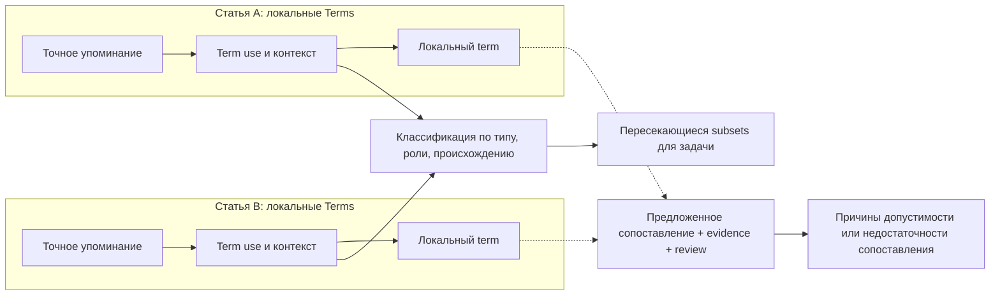

# ARIADNE: contextual Terms storage and review concept v0.1

Дата: 13 октября 2026, Asia/Yekaterinburg.
Статус: **предложение для обсуждения**, не реализованная схема и не научно
принятая классификация. Документ не меняет production database, extraction,
retrieval, glossary или сохранённые результаты TAC stage08.

Поэтапная реализация и критерии приёмки: [implementation plan](terms_implementation_plan_2026-10-13.md).

## 1. Предлагаемое продуктовое решение

Сохранить Terms отдельно для каждой статьи, но добавить проверяемые связи между
упоминаниями, контекстами и представлениями. Главная рабочая задача: быстро
найти не только нужное понятие, но и его роль, источник и ограничения
сопоставления с другой работой.

Subsets должны быть представлениями над этими данными, а не единственным местом
хранения. Пользователь может менять классификацию и исследовательский вопрос,
не переизвлекая исходный текст и не теряя прежние решения.

Кандидат на продуктовое отличие — воспроизводимый локальный workflow
«упоминание → контекст → предложенная связь → проверка → сопоставление работ»,
который объясняет также недостаточность данных для связи. Его преимущество
должно измеряться на реальных задачах; мировая новизна не установлена.

## 2. Что проверено в текущем проекте

В `scripts/tac_terms.py`, `tac_term_candidates_v0.3`:

- Лексические кандидаты строятся только по существующим T/A/C предложениям.
- У выбранных Terms есть точные quotations, page/offsets/layer identities,
  article/PDF provenance, methods, seed concepts и boundary review status.
- `max_terms=12` ограничивает **сохраняемый** список `terms`, а не только HTML
  preview. Остальные кандидаты сохраняются лишь как число `candidate_count`.
- Вложенные фразы могут быть исключены из выбранного списка; это поверхностное
  подавление, не установленная синонимия или научная иерархия.
- Ранжирование учитывает T/A/C, частоты и длину фразы; score не является
  вероятностью корректности. Категории, semantic relations и решения научного
  reviewer для Terms этим модулем не реализованы.

В существующем draft contract experimental records отдельно описаны sample,
material form, property, conditions, method и origin с exact evidence. Его
технические integrity/readiness проверки не устанавливают научное связывание.
Предложение ниже должно согласовываться с этим контрактом; Terms не заменяют
полную experimental record.

## 3. Минимальная модель хранения

Все названия объектов ниже предложены; они не являются существующими таблицами,
функциями или согласованным JSON contract.

| Объект | Что хранить | Ограничение |
| --- | --- | --- |
| Source mention | Exact text, article, original PDF hash/path, page, selected layer identity, page text hash, offsets, containing source context | Неизменный источник; многословная фраза и переносы сохраняются |
| Article-local term | Локальный ID, display label, ссылки на упоминания, extraction method/version | Одинаковая строка в разных статьях не означает одну научную сущность |
| Term use | Ссылки на упоминания и конкретный контекст; предложенные type/role/sample/condition references | Один term может иметь разные роли даже в одной статье |
| Classification assertion | Term use, axis/category, evidence или explicit policy rule, producer/version, review state | Классификация и её проверка хранятся отдельно от текста |
| Relation assertion | Endpoints, relation type, evidence contexts, origin, uncertainty, review state | Совместное присутствие слов не подтверждает научную связь |
| Review event | Что проверено, решение, причина, reviewer, время, superseded decision | История сохраняется; машинная integrity не равна scientific acceptance |
| View definition | Фильтр, порядок, taxonomy/review/input versions | Subset воспроизводим для выбранной версии |

Локальный term может объединять несколько буквальных упоминаний для навигации,
но разные контекстные употребления остаются отдельными. Полисемию нельзя
скрывать агрегацией. Общий справочник понятий допустим как дополнительный слой
ссылок; он не заменяет локальные Terms и не сливает их evidence.

Межстатейные mapping links предлагаются и проверяются отдельно. Общая метка,
перевод или аббревиатура не создают автоматическую эквивалентность. Сопоставление
понятий не означает сопоставимость экспериментов. Не делать автоматическую
транзитивную склейку цепочки предложенных mappings.

## 4. Subsets по нескольким независимым осям

Исходный вариант смешивал «что это» и «как это используется». Для дальнейшего
review предлагается разделить оси:

1. **Тип понятия:** substance/material, object, property, process, method,
   condition, unclassified. Это рабочая таксономия, требующая domain review.
2. **Роль в выбранном контексте:** исследуемый объект, компонент состава,
   сравнение/контроль, метод, фоновое упоминание, неопределённая роль. Принадлежность
   назначается Term use; одна роль не переносится автоматически на всю статью.
3. **Происхождение:** авторское сообщение, цитируемая работа, предположение,
   не определено. Происхождение должно опираться на контекст, а не на наличие
   reference marker рядом с отдельным словом.
4. **Состояние проверки:** предложено, требует уточнения, подтверждено reviewer,
   отклонено. Integrity status и состояние scientific review раздельны.
5. **Охват источников:** T/A/C или дополнительно проверенные full-text regions.
   TAC-only не выдаётся за анализ полной статьи.

Пример динамического subset: «properties исследуемых материалов, с проверенной
связью property-of, без фоновых цитируемых употреблений». Это запрос к локальным
Terms/contexts, а не новая копия терминов. Неопределённые роли показываются как
отдельные результаты, а не теряются без диагностики.

Число categories не зависит от длины фразы. Для составной фразы основная
категория определяется её смыслом; упомянутые составляющие получают отдельные
связи. Непересекаемость subsets не требуется.

## 5. Различать три класса связей

- **Лексическая:** в конкретном source span длинная фраза содержит короткую.
  Проверяется offsets/текстом; не устанавливает scientific broader/narrower.
- **Контекстная/научная:** property-of, component-of, measured-by,
  under-condition и другие отношения. Требует собственного evidence и review.
  Связь «получено методом X» не переносится на цитируемый результат Y.
- **Сопоставление между статьями:** possible same concept, broader/narrower
  mapping или different usage. Хранится как отдельное решение, сохраняющее обе
  локальные записи. Возможны неоднозначность и отказ от связи.

Пример ниже **синтетический**, не извлечение из текущего корпуса:

## 6. Предлагаемые отличия в процессе работы

### 6.1. Проверка связи одним действием

Выбор связки property/material открывает точные контексты обоих концов и
фрагмент, предложенный как доказательство связи. Пользователь может подтвердить,
исправить endpoints или отклонить связь. Наличие цитаты проверяется отдельно
от того, доказывает ли она эту связь.

### 6.2. Объяснение препятствий сопоставлению

Для пары Term uses показывать, какие сведения совпадают, различаются или
не установлены: material form, sample identity, temperature, medium/composition,
method, origin. Одинаковые labels не разрешают сравнение значений. Статусы
«контекст неполон», «установлены различия» и «требуется экспертная проверка»
полезнее автоматической склейки. Различие условий само по себе не доказывает
противоречие результатов; правила научной сопоставимости согласуются отдельно.

Terms layer может направить пользователя к experimental record, но не выводит
числовые результаты или условия из самой фразы и не объявляет совместимость
по одному терминологическому совпадению.

### 6.3. Очередь review с причинами

Выделять полисемию, неподтверждённые mapping links, candidate relations с
несколькими возможными sample endpoints и source boundary failures. Показывать
причину приоритета и область применения. Непроверенные предложения не получают
выдуманную confidence probability.

### 6.4. Пересмотр без потери истории

Сохранённый subset воспроизводится по frozen input, extractor/taxonomy versions
и набору review events. При изменении источника или правил показывается diff
затронутых упоминаний, classifications и relations. Старое решение сохраняется;
его пригодность для новых inputs требует явной проверки. Новая классификация
не перезаписывает старую запись и не меняет original PDF.

### 6.5. Результат запроса вместе с его границами

Показывать не только найденные Terms, но и не классифицированные кандидаты,
скрытые preview limit результаты и заявленный source scope. Отсутствие термина
в TAC не означает отсутствия понятия в статье. Система не должна обещать
полноту, которую не проверяла.

## 7. Что уже встречается у аналогов

Обзор ограничен официальными описаниями нескольких систем; это не exhaustive
comparison и не установление отсутствия функций у конкурентов. Проверено
13 октября 2026 года.

- SKOS описывает concept schemes, lexical labels, collections и semantic/mapping
  relations; один concept может участвовать в нескольких schemes. Категории,
  пересечения и концептуальные связи сами по себе не новы.
  [W3C SKOS Reference](https://www.w3.org/TR/skos-reference/).
- VOSviewer поддерживает term co-occurrence networks, clustering и thesaurus
  cleaning. Граф и группировка терминов сами по себе не являются уникальным
  преимуществом. [VOSviewer Features](https://www.vosviewer.com/features).
- Elicit описывает review workflow, supporting quotes, экспертный контроль и
  extraction со ссылками на конкретные источники. Цитаты и review сами по себе
  не являются новым решением.
  [Elicit: PRISMA 2020 workflow](https://elicit.com/blog/systematic-review-for-prisma-2020).

ARIADNE может исследовать преимущество конкретной комбинации: article-local
Terms, source-exact context/relations, причины несопоставимости научных данных,
история решений и воспроизводимая локальная работа. Отдельные компоненты
известны; ценность комбинации и её отличие от конкретных продуктов пока гипотезы.

## 8. Порядок реализации и приёмки

1. **Полный инвентарь.** Новый версионированный sidecar сохраняет все произведённые
   лексические кандидаты и exact occurrences. Preview limit отделяется от
   хранения; nested phrases сохраняются с объяснением display suppression.
   Не обещать сохранения всех научно полезных terms: candidate generation всё
   ещё имеет ограниченный recall. Production scoring и glossary не меняются.
2. **Контексты и оси.** Добавить предложенные classifications и context-scoped
   usages с явным unclassified состоянием. HTML сохраняет восемь основных
   колонок; категории и source/review отображаются внутри Terms. Не выдавать
   classifying rules за принятую научную taxonomy.
3. **Проверяемые отношения.** Сначала немного явно поддерживаемых relation types
   и ручной review. Co-occurrence отображать отдельно от asserted relations.
   Scientific labels требуют самостоятельной разметки и adjudication.
4. **Сопоставление работ.** Использовать reviewed contexts/records; проверить
   пользователю полезность объяснения несовпадений и неполноты. Научный admission
   и production migration оформляются отдельной задачей.

Безопасный первый prototype — новые изолированные JSON sidecars и HTML review.
Специализированная graph database не требуется для проверки концепции. Физическая
схема БД и индексы выбираются после стабильного контракта и измерения workloads.

Метрики пилота: полезные Terms/пропуски по независимой разметке; correctness
classifications и relations; ошибки article/sample/condition/origin linkage;
время до проверенной подборки; исправления на задачу; доля решений с проверяемым
источником; воспроизводимость сохранённого view. Метрики оцениваются раздельно,
без смешивания output counts, integrity и scientific correctness.

Сравнение проводить на одинаковых документах, задачах и критериях, с baseline
текущего flat Terms workflow и выбранными аналогами. Заранее определить цели;
числа преимущества сейчас не заданы и не измерены. Дубликаты одной работы не
разносить по train/development и holdout. Существующие 33 документа уже
использовались для разработки и не становятся независимым holdout от переименования.

## Changed / Tests run / Limitations / Verdict

Changed: подготовлена концепция и порядок её проверки; runtime code, scientific
outputs и database schema этим документом не изменены.

Tests run: прочитаны текущая реализация Terms, source/review contract и официальные
страницы аналогов/стандарта. Runtime tests в рамках концептуальной задачи не
запускались; результаты предыдущего stage08 не считаются новыми проверками.

Limitations: taxonomy, relations, cross-article mapping, comparability rules и
quality/time advantage не приняты и не измерены. Независимая разметка и полное
конкурентное исследование отсутствуют. Приведённая схема не реализована.

Verdict: предложено развитие article-local Terms до source-bound contextual
workflow. Первый технический шаг — сохранение полного candidate inventory с
отдельным preview limit; затем ограниченный classification/relation pilot.
